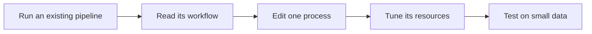
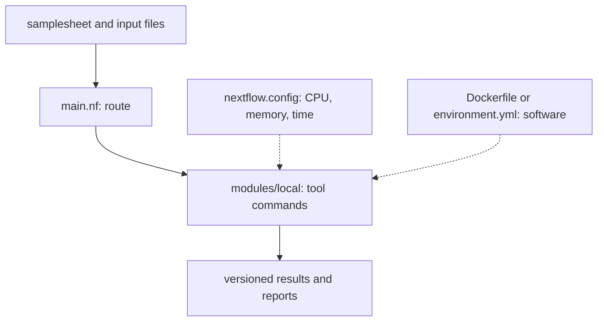
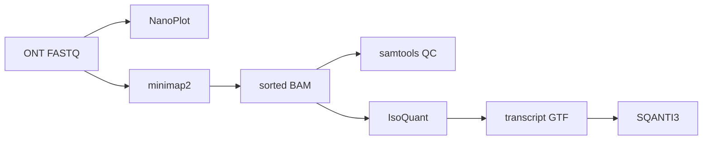

# Build A Reproducible ONT Isoform Pipeline With Nextflow

**Takeaway:** A custom Nextflow pipeline is a set of small tool commands connected by a readable workflow. Once you know which file controls the route, the command, the software, and the compute, it becomes much easier to build one safely.

[Week 5](week-05-nextflow-nfcore-rnaseq.html) showed how to run the community-maintained `nf-core/rnaseq` pipeline. This week, we open the hood and build a focused pipeline for Oxford Nanopore Technologies (ONT) isoform discovery.

[Open the complete, tested Week 6 project on GitHub](https://github.com/Caffeinated-Code/Bioinformatics_Field_Guide/tree/main/content/resources/week-06).

## From Pipeline User To Pipeline Builder

Use a mature pipeline when it already answers your question. Build a custom pipeline when you need a different sequence of tools, a new method, unusual inputs, or outputs that an existing pipeline does not provide. [Week 5 explains what nf-core adds](week-05-nextflow-nfcore-rnaseq.html#what-nf-core-adds) and why it should remain your first choice for standard analyses.



You do not need to learn all of Nextflow before writing useful code. Start with four ideas:

| Nextflow idea | Plain-language meaning |
|---|---|
| process | one reproducible task, such as running `minimap2` |
| channel | the path that carries files and metadata between tasks |
| workflow | the order in which processes are connected |
| configuration | where compute, containers, profiles, and reporting are controlled |

For a refresher, see [Nextflow's process-channel model](week-05-nextflow-nfcore-rnaseq.html#what-nextflow-is) and [how independent samples run in parallel](week-05-nextflow-nfcore-rnaseq.html#how-nextflow-parallelizes).

## The Project In One Picture

Each concern has a home. This separation is what makes a custom pipeline maintainable.



```text
week-06/
├── main.nf                         # Connects the analysis steps
├── nextflow.config                 # CPUs, memory, time, profiles, reports
├── params.local.yml                # Input and output paths
├── samplesheet_ont.csv             # Sample metadata and FASTQ paths
├── Dockerfile                      # Reproducible software image
├── environment.yml                 # Conda alternative for Linux/x86
└── modules/local/
    ├── fastq_qc.nf                 # NanoPlot
    ├── align_minimap2.nf           # minimap2 and samtools
    ├── alignment_qc.nf             # samtools QC
    ├── isoquant_discovery.nf       # IsoQuant transcript discovery
    └── sqanti3_annotation.nf       # SQANTI3 classification
```

When you customize this project, you will usually edit only one of three places:

| What you want to change | File to edit |
|---|---|
| samples, references, or output directory | [`samplesheet_ont.csv`](https://github.com/Caffeinated-Code/Bioinformatics_Field_Guide/blob/main/content/resources/week-06/samplesheet_ont.csv) or [`params.local.yml`](https://github.com/Caffeinated-Code/Bioinformatics_Field_Guide/blob/main/content/resources/week-06/params.local.yml) |
| a tool command or its scientific options | the relevant file in [`modules/local/`](https://github.com/Caffeinated-Code/Bioinformatics_Field_Guide/tree/main/content/resources/week-06/modules/local) |
| CPU, memory, run time, or execution platform | [`nextflow.config`](https://github.com/Caffeinated-Code/Bioinformatics_Field_Guide/blob/main/content/resources/week-06/nextflow.config) |

## The Scientific Goal

The example starts with ONT reads and produces transcript models classified against a reference annotation.



| Step | Main output | Question answered |
|---|---|---|
| NanoPlot | read QC report | Are read length and quality usable? |
| minimap2 + samtools | sorted, indexed BAM | Where do the reads align? |
| samtools QC | mapping summaries | Did alignment behave as expected? |
| IsoQuant | non-redundant transcript models | Which isoforms are supported by the reads? |
| SQANTI3 | classification and QC tables | How do those models compare with known annotation? |

IsoQuant performs transcript discovery and redundancy reduction. SQANTI3 evaluates the resulting models; it is not the collapse step.

### Record The ONT Protocol

The same analysis options are not correct for every ONT library.

| Protocol | What is sequenced | Pipeline consequence |
|---|---|---|
| direct RNA | native RNA | directional; use direct-RNA-aware alignment and strand settings |
| direct cDNA | unamplified cDNA | avoids PCR amplification but still reflects reverse-transcription artifacts |
| PCR-cDNA | amplified cDNA | often higher yield; inspect amplification bias, duplicates, and chimeras |

The samplesheet stores `protocol` for each sample. The pipeline uses it to select alignment and strand settings per sample.

### How The Minimap2 Command Changes

All three protocols need splice-aware alignment, but they do not have the same orientation and error profile. The [minimap2 long-RNA cookbook](https://github.com/lh3/minimap2/blob/master/cookbook.md#mapping-long-rna-seq-reads) recommends the following starting points.

```bash
# Direct RNA: stranded and typically noisier.
minimap2 -ax splice -uf -k14 -t 8 reference.fa direct_rna.fastq.gz

# Direct cDNA: do not force transcript orientation unless it is known.
minimap2 -ax splice -t 8 reference.fa direct_cdna.fastq.gz

# PCR-cDNA: the core alignment preset is the same as direct cDNA.
minimap2 -ax splice -t 8 reference.fa pcr_cdna.fastq.gz
```

| Parameter | What it does | Why it matters here |
|---|---|---|
| `-a` | writes SAM alignments | `samtools sort` needs SAM/BAM-compatible output |
| `-x splice` | selects the long-read spliced-alignment preset | allows long introns and reports introns with the `N` CIGAR operation |
| `-u f`, written as `-uf` | tells minimap2 that reads follow the forward **transcript** strand | appropriate for ONT direct RNA; this does not mean the forward genomic strand |
| `-k14` | uses 14-base minimizer seeds instead of the preset's longer seed | improves sensitivity for noisier direct RNA reads, with a possible speed and specificity cost |
| `-t 8` | uses eight alignment threads | changes performance, not the scientific model |

PCR amplification changes yield, duplication, and chimera risk, but it does not by itself require a different minimap2 preset. For both cDNA protocols, the pipeline leaves orientation unconstrained so minimap2 can infer it from splice signals. Add `-uf` only when preprocessing and library metadata demonstrate that every retained read is oriented with the transcript.

For SIRV controls, `--splice-flank=no` may improve junction accuracy because SIRV constructs do not follow the genomic splice-flank pattern modeled by default. Do not carry that option into human or mouse data without a reason. An annotation-derived `--junc-bed` can favor known junctions, but it changes alignment scoring and should be recorded when novel isoforms are the goal.

The protocol switch in `align_minimap2.nf` is intentionally small:

```nextflow
// Direct RNA receives the two extra flags; both cDNA protocols receive none.
def extra = meta.protocol == 'directRNA' ? '-uf -k14' : ''

minimap2 -ax splice ${extra} -t ${task.cpus} ${reference} ${fastq}
```

This pipeline gives IsoQuant an already aligned BAM, so protocol-specific orientation is handled here, during alignment. IsoQuant's `--stranded` option is omitted: it must not be treated as a way to repair a BAM aligned with the wrong orientation.

## Read `main.nf` Like A Plan

The top of `main.nf` imports reusable processes:

```nextflow
include { FASTQ_QC } from './modules/local/fastq_qc'
include { ALIGN_MINIMAP2 } from './modules/local/align_minimap2'
include { ALIGNMENT_QC } from './modules/local/alignment_qc'
include { ISOQUANT_DISCOVERY } from './modules/local/isoquant_discovery'
include { SQANTI3_ANNOTATION } from './modules/local/sqanti3_annotation'
```

The `workflow` block then connects them:

```nextflow
FASTQ_QC(ch_reads)

ALIGN_MINIMAP2(ch_reads, ch_reference)
ALIGNMENT_QC(ALIGN_MINIMAP2.out.bam)
ISOQUANT_DISCOVERY(ALIGN_MINIMAP2.out.bam, ch_reference, ch_annotation)
SQANTI3_ANNOTATION(ISOQUANT_DISCOVERY.out.models, ch_annotation, ch_reference)
```

Read this from top to bottom as a data route. `ALIGN_MINIMAP2.out.bam` becomes input to both alignment QC and IsoQuant. Those consumers can run as soon as a sample's BAM is ready; Nextflow does not wait for every sample to finish first.

The samplesheet is converted into a channel containing a metadata map and a FASTQ file:

```nextflow
tuple(
  [ id: row.sample, protocol: row.protocol, condition: row.condition ],
  file(row.fastq, checkIfExists: true)
)
```

Keeping metadata beside the file prevents sample identity and protocol from being lost as data move through the workflow. This is the same [samplesheet-as-contract principle](week-05-nextflow-nfcore-rnaseq.html#the-samplesheet-is-the-contract) used by nf-core.

## A Process Is One Reusable Step

Here is the project's actual IsoQuant module. The comments are part of the downloadable file, so the code can also serve as a compact reference while you edit it.

```nextflow
process ISOQUANT_DISCOVERY {
  // Show the sample ID beside this task in the Nextflow log.
  tag "${meta.id}"

  // Apply the high-resource CPU, memory, and time settings from nextflow.config.
  label 'process_high'

  // Copy final deliverables from Nextflow's work directory into the results folder.
  publishDir "${params.outdir}/isoquant", mode: 'copy'

  // Use the container with Docker/Singularity profiles or Conda with the Conda profile.
  container 'biofield/ont-isoforms:2026.10'
  conda 'bioconda::isoquant=4.0.0'

  // Declare every file and metadata object required by one task.
  input:
  tuple val(meta), path(bam), path(bai)
  path reference
  path annotation

  // Name the transcript-model GTF for SQANTI3 and retain the complete IsoQuant folder.
  output:
  tuple val(meta), path("${meta.id}.transcript_models.gtf"), emit: models
  tuple val(meta), path("${meta.id}.isoquant"), emit: results

  script:
  """
  # Stop on an error, an unset variable, or a failed command inside a pipe.
  set -euo pipefail

  # Reconstruct and quantify ONT transcript models against the supplied annotation.
  isoquant --data_type nanopore --bam ${bam} --reference ${reference} \
    --genedb ${annotation} --complete_genedb \
    --threads ${task.cpus} --prefix ${meta.id} --output ${meta.id}.isoquant

  # Find the model GTF produced inside IsoQuant's version-specific output tree.
  model_gtf=\$(find ${meta.id}.isoquant -type f -name '*transcript_models.gtf' -print -quit)

  # Fail the task if IsoQuant completed without creating the expected GTF.
  test -n "\${model_gtf}"

  # Give the GTF a stable name for the next Nextflow process.
  cp "\${model_gtf}" ${meta.id}.transcript_models.gtf
  """
}
```

The Nextflow directives define the task contract:

| Line | Concise meaning |
|---|---|
| `process ISOQUANT_DISCOVERY {` | defines a reusable task named `ISOQUANT_DISCOVERY` |
| `tag "${meta.id}"` | displays the sample ID in logs and reports |
| `label 'process_high'` | selects the high-resource settings in `nextflow.config` |
| `publishDir ... mode: 'copy'` | copies final files into `results/.../isoquant`; downstream tasks still use the output channel |
| `container ...` | pins the Docker/Singularity image |
| `conda ...` | pins the Conda package when the Conda profile is enabled |
| `input:` | begins the input declaration |
| `tuple val(meta), path(bam), path(bai)` | keeps sample metadata, sorted BAM, and BAM index together |
| `path reference` | stages the reference FASTA into the task directory |
| `path annotation` | stages the matching GTF/GFF annotation |
| `output:` | begins the output declaration |
| `...transcript_models.gtf..., emit: models` | exposes a stable GTF output named `models` for SQANTI3 |
| `...isoquant..., emit: results` | retains IsoQuant's complete output directory as `results` |
| `script:` | begins the code that builds and runs the shell command |
| `""" ... """` | encloses the Bash script while allowing Nextflow variables to be inserted |

The shell script then runs and verifies IsoQuant:

| Line or option | Concise meaning |
|---|---|
| `set -euo pipefail` | stops on failed commands, unset variables, or failed pipelines |
| `--data_type nanopore` | selects IsoQuant's ONT-specific algorithm settings |
| `--bam ${bam}` | supplies the sorted, indexed long-read alignments |
| `--reference ${reference}` | supplies the reference genome; required even with BAM input |
| `--genedb ${annotation}` | supplies known genes and transcripts for guided discovery and classification |
| `--complete_genedb` | marks an official annotation with gene and transcript features, speeding database preparation |
| `--threads ${task.cpus}` | uses the CPU allocation from `nextflow.config` |
| `--prefix ${meta.id}` | names outputs with the sample ID |
| `--output ${meta.id}.isoquant` | writes the full IsoQuant result directory |
| `model_gtf=$(find ... -print -quit)` | finds the first transcript-model GTF inside that directory |
| `test -n "${model_gtf}"` | fails immediately if no model GTF was found |
| `cp ... ${meta.id}.transcript_models.gtf` | creates the predictable filename declared in `output:` |

Notice `${task.cpus}` in the IsoQuant command. The module does not hard-code a thread count; it uses the CPUs assigned by the configuration.

## Change Memory Without Rewriting The Process

The module uses `label 'process_high'`. That label maps to a resource block in `nextflow.config`:

```nextflow
process {
  withLabel: process_low {
    cpus = 1
    memory = '2 GB'
    time = '2h'
  }

  withLabel: process_high {
    cpus = 4
    memory = '8 GB'
    time = '12h'
  }
}
```

If IsoQuant needs more memory but the other high-resource processes do not, place a process-specific override **after** the label blocks inside the existing `process { ... }` section:

```nextflow
process {
  // Existing label blocks remain above this override.
  withName: ISOQUANT_DISCOVERY {
    cpus = 8
    memory = '16 GB'
    time = '24h'
  }
}
```

Now `${task.cpus}` becomes `8` inside the IsoQuant command. The scientific module remains unchanged, while local, HPC, and cloud profiles can request different hardware.

Nextflow also writes `trace.txt`, `report.html`, `timeline.html`, and `dag.html`. Use the trace to compare requested resources with run time and memory use before increasing every task "just in case."

## Three Safe Ways To Customize This Pipeline

1. **Change the data.** Edit `samplesheet_ont.csv` and `params.local.yml`; do not embed personal paths inside modules.
2. **Change one scientific command.** Edit the relevant module, keep its input and output contract stable, and test it on the toy dataset.
3. **Change compute separately.** Adjust a label or add a `withName` override in `nextflow.config`.

Use this loop whenever you experiment:


Nextflow caches completed tasks. After an edit, `-resume` reruns only work affected by the change. [Week 5 explains caching and `-resume`](week-05-nextflow-nfcore-rnaseq.html#caching-and--resume) in more detail.

## Run The Verified Toy Project

Run these commands in a terminal from the repository root, not inside JupyterLab.

```bash
# 1. Download IsoQuant's small public simulated ONT dataset.
bash content/resources/week-06/prepare_toy_test.sh

# 2. On Apple Silicon, start Colima as the Docker runtime.
# Skip this line if Docker Desktop is already running.
colima start --cpu 4 --memory 8

# 3. Build the pinned image containing all pipeline tools.
bash content/resources/week-06/build_container.sh

# 4. Run the complete workflow and reuse valid cached tasks.
nextflow run content/resources/week-06/main.nf \
  --input data/isoquant_toy/samplesheet.csv \
  --reference data/isoquant_toy/chr9.4M.fa.gz \
  --annotation data/isoquant_toy/chr9.4M.gtf.gz \
  --outdir results/week06-toy \
  -profile docker \
  -resume
```

Expected result folders:

```text
results/week06-toy/
├── fastq_qc/
├── alignments/
├── alignment_qc/
├── isoquant/
├── sqanti3/
└── pipeline_info/
```

The tested toy run produced:

```text
FASTQ reads:                  439
Primary alignments:           439 (100%)
IsoQuant transcript models:    30
SQANTI3 classification rows:   30
```

The 100% mapping rate is expected for simulated reads generated from this small reference; it is not a benchmark for biological ONT data. The run was verified with Nextflow 26.04.2 on Apple Silicon using Colima with 4 CPUs, 8 GiB memory, and a 40 GiB virtual disk.

The first container build can take several minutes and uses about 3.16 GB. On Apple Silicon, Docker or Colima is the supported path because IsoQuant 4.0.0's current dependency chain does not resolve natively on `osx-arm64`.

## Debug By Looking In The Right Place

| What went wrong | Check first | Likely next action |
|---|---|---|
| Nextflow syntax or channel error | `.nextflow.log` | inspect `main.nf` near the reported line |
| one tool failed | the task's `work/.../.command.err` | read the tool error before changing resources |
| task exited with code 137 | `trace.txt` and `.command.err` | increase memory for that process only |
| expected output is missing | module `output:` block and `.command.out` | match the declared filename to the real filename |
| a small edit reruns everything | launch directory and `-resume` | run from the same directory with the same work cache |

The work directory is not clutter to delete during debugging. It contains the exact command, environment, standard output, and error for each task.

## Before You Use Real Data

- Confirm that FASTA and GTF use the same genome build and contig names.
- Record direct RNA, direct cDNA, or PCR-cDNA for every sample.
- Inspect read and alignment QC before interpreting isoforms.
- Treat "novel" as a classification, not proof of biological function.
- Require read support, coherent splice junctions, compatible strand, replicate evidence, and relevant external evidence.
- Build a shared, filtered transcript catalog before comparing isoform abundance across samples.

This teaching workflow discovers models per sample. For differential transcript usage, perform joint or reconciled discovery, freeze one validated annotation, and quantify every sample against that same feature set.

## You Now Have A Pattern To Reuse

To build another custom pipeline:

1. Write the input contract.
2. Put one tool or scientific action in each process.
3. Connect declared outputs to the next process's inputs.
4. Keep software and compute configuration outside the command logic.
5. Test on the smallest dataset that can prove the workflow works.

The biological tools will change. This structure does not. Start by copying one module, changing its command and output contract, and connecting it in `main.nf`. That is already custom pipeline development.

Use `nf-core/nanoseq` when you need community-maintained Nanopore preprocessing, QC, demultiplexing, and alignment. Use this focused project when transcript discovery, protocol-aware settings, IsoQuant models, and SQANTI3 classification are the central deliverables.

## Next In The Series

Continue with [Week 7](week-07-rnaseq-in-seven-minutes.html) to add fast contract tests, scientific assertions, GitHub Actions, and Jenkins to this exact pipeline.

## Credits And References

- [Nextflow documentation](https://www.nextflow.io/docs/latest/)
- [nf-core/nanoseq](https://nf-co.re/nanoseq/)
- [IsoQuant documentation and public test data](https://github.com/ablab/IsoQuant)
- Prjibelski AD et al. [IsoQuant: a tool for accurate novel isoform discovery with long reads](https://doi.org/10.1186/s13059-023-02898-2). *Genome Biology*. 2023.
- [SQANTI3 documentation](https://github.com/ConesaLab/SQANTI3)
- Pardo-Palacios FJ et al. [SQANTI3: curation of long-read transcriptomes](https://doi.org/10.1038/s41592-024-02229-2). *Nature Methods*. 2024.
- [minimap2 documentation](https://github.com/lh3/minimap2)
