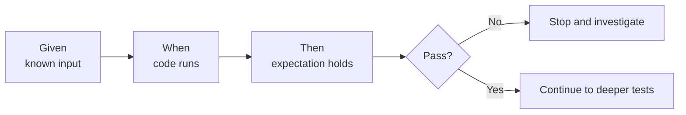
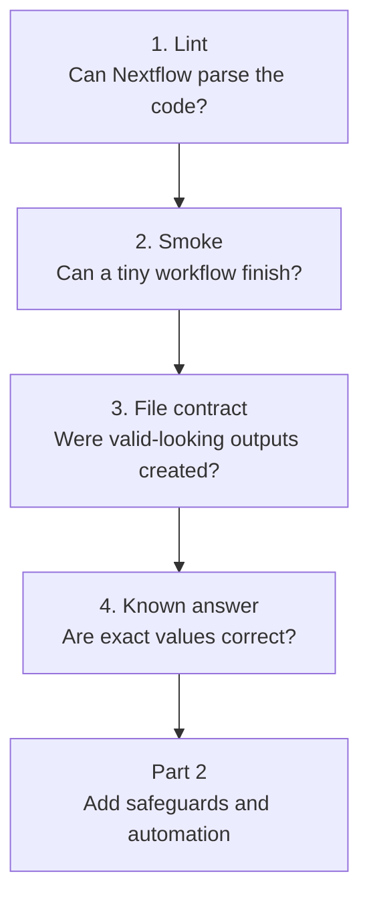
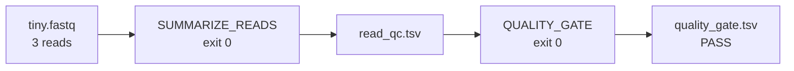

# Bioinformatics CI/CD: Test Locally

<div class="scenario-panel">
<p class="eyebrow">A biotech release is due Friday</p>
<p>A translational team reruns its Oxford Nanopore isoform pipeline before choosing targets for wet-lab validation. The workflow finishes, but the transcript count changed. Was it the biology? A parameter? A tool update? A missing sample?</p>
<p><strong>A completed run is not proof of a correct result. Tests show what changed before that result reaches the laboratory.</strong></p>
</div>

**Takeaway:** Start with one tiny input whose answer you know. In this first part, you will check that the workflow parses, runs, creates the promised files, and returns the correct values.

[Week 5](week-05-nextflow-nfcore-rnaseq.html) introduced Nextflow. [Week 6](week-06-build-custom-nextflow-ont-pipeline.html) built an ONT workflow from FASTQ through IsoQuant and SQANTI3. This guide makes that workflow safer to change and release.

[Open the complete testing project on GitHub](https://github.com/Caffeinated-Code/Bioinformatics_Field_Guide/tree/main/content/resources/week-07). Both parts use this one project so the local tests and automated tests cannot drift apart.

## The Mental Model Before The Code

| Term | Meaning in this guide |
|---|---|
| **fixture** | a small input used for testing; here, a three-read FASTQ |
| **test** | one question about what the code should do |
| **assertion** | one condition that must be true |
| **exit code** | `0` means a command succeeded; non-zero means it failed |
| **test harness** | a script that runs the test and checks its result |
| **regression** | a result that changed after the code or software changed |
| **CI** | run tests automatically when code changes |
| **CD** | prepare and promote a tested, versioned release |

A test can be read as a sentence:

> Given this known input, when this code runs, then this specific result must be true.



You decide what is correct. CI is simply another computer that checks those decisions every time the code changes.

## A Five-Minute First Win

### Clone The Project Once

The Week 7 sandbox is self-contained. The lint example also inspects the custom pipeline from Week 6, so keep both directories in their original locations.

They are already part of the same repository. **Clone once; do not clone Week 6 inside Week 7.** A nested clone would create the wrong paths.

```bash
# Clone the complete Field Guide. This downloads both Week 6 and Week 7.
git clone https://github.com/Caffeinated-Code/Bioinformatics_Field_Guide.git

# Enter the repository root. Run the remaining commands from here.
cd Bioinformatics_Field_Guide

# Confirm that both required projects are in their expected sibling locations.
ls content/resources/week-06/main.nf \
   content/resources/week-07/sandbox/main.nf
```

Expected output:

```text
content/resources/week-06/main.nf
content/resources/week-07/sandbox/main.nf
```

For the first win, you need Nextflow, Java, Bash, and Python 3. You do not need Docker, nf-test, minimap2, IsoQuant, or SQANTI3.

### Conda Fallback: Create The Tested Tool Set In One Step

Already have compatible tools? Skip this section. If a command is missing or the versions conflict, create the included environment:

```bash
# Create the environment once from the repository root.
conda env create --file content/resources/week-07/environment.yml

# Activate it whenever you return to this tutorial.
conda activate bioinfo-ci-basics

# Confirm that all four commands now come from a compatible tool set.
nextflow -version
java -version
bash --version | head -n 1
python3 --version
```

Expected version lines:

```text
nextflow version 26.04.2
openjdk version "17..."
GNU bash, version 5.2...
Python 3.11...
```

If the environment already exists and the YAML file changes later, update it instead:

```bash
conda env update --file content/resources/week-07/environment.yml --prune
```

The YAML lists `conda-forge` before `bioconda` because environment files list the highest-priority channel first. It also excludes the old `defaults` channel. This follows [Bioconda's current channel guidance](https://bioconda.github.io/).

This is a practical backup for the tutorial. [Nextflow's installation guide](https://docs.seqera.io/nextflow/install) warns that Conda packages can lag or develop Java conflicts, so the self-installing Nextflow package remains the preferred option for a production installation. Here, exact pins make the small teaching environment reproducible.

```bash
# Run a real two-process Nextflow workflow, inspect its files, and test values.
bash content/resources/week-07/scripts/run_sandbox.sh
```

Expected final output:

```text
File contract: PASS (two non-empty TSV files with metric/value headers)

Ran 6 tests in 0.001s
OK

QC summary
metric          value
reads           3
bases           36
mean_length     12.0
min_length      8
max_length      16

Gate decision
metric          value
status          PASS
reads           3
minimum_reads   3
```

### What Did That One Command Actually Run?

`run_sandbox.sh` is the **test harness**. It runs three layers in order:

```bash
# Layer 1: run the Nextflow workflow on the known three-read FASTQ.
nextflow run "${resource_dir}/sandbox/main.nf" \
  --reads "${resource_dir}/sandbox/data/tiny.fastq" \
  --min_reads 3 \
  --outdir "${outdir}" \
  -work-dir "${workdir}" \
  -ansi-log false

# Layer 2: inspect the two files Nextflow published.
for result_file in read_qc.tsv quality_gate.tsv; do
  # The full loop checks file size and the metric/value header.
  result_path="${outdir}/${result_file}"
done

# Layer 3: discover and run every test_*.py file against those results.
QC_RESULTS="${outdir}" python3 -m unittest discover \
  -s "${resource_dir}/sandbox/tests" \
  -p 'test_*.py' \
  -v
```

This block is an execution map, not a replacement for the documented source file. The next four sections open each check, explain what makes it pass, and show how it fails. [Read the complete wrapper](https://github.com/Caffeinated-Code/Bioinformatics_Field_Guide/blob/main/content/resources/week-07/scripts/run_sandbox.sh).

The fixture contains read lengths of 12, 8, and 16 bases. You can verify its expected answers without software: `3` reads, `36` bases, mean length `12`, minimum `8`, and maximum `16`.

## Four Tests To Start With



### 1. Lint: Read The Code Without Running It

**Real-life situation:** You edit a Nextflow process and forget one closing brace. Without linting, the job may wait in an HPC queue before it fails. That wastes time and compute.

**What this test does:** Linting reads the code without running the pipeline. Think of it as a grammar check for Nextflow scripts and configuration files.

```bash
# Parse every Nextflow script and configuration file in Week 6.
nextflow lint content/resources/week-06
```

Expected output:

```text
Nextflow linting complete!
8 files had no errors
```

If the final `}` is missing from a workflow, the real linter output is concise:

```text
Error main.nf:14:1: Unexpected input: '<EOF>'

Nextflow linting complete!
1 file had 1 error
```

`<EOF>` means "end of file." Nextflow reached the last line while it was still waiting for more code.

| Lint can catch | Lint cannot prove |
|---|---|
| missing braces or invalid syntax | minimap2 can align the reads |
| malformed configuration | a reference and annotation use the same build |
| deprecated or suspicious constructs | output values are biologically correct |
| some style and code-quality issues | the workflow has enough memory at scale |

Run lint before every commit. It is fast, and it removes simple syntax errors before deeper tests begin.

### 2. Smoke Test: Run The Smallest Meaningful Path

**Real-life situation:** A container was updated or a new process was added. Before running 300 samples, you need to know whether one tiny sample can still travel through the main workflow.

**What this test does:** A smoke test runs the smallest useful path from input to output. It answers one question: **can the workflow finish without crashing?**

The sandbox runs this real path:



The wrapper uses the `nextflow run` command from the first-win section. Nextflow runs `SUMMARIZE_READS` first. When its metrics file is ready, Nextflow sends that file to `QUALITY_GATE`.

These log lines confirm both tasks were submitted:

```text
Submitted process > SUMMARIZE_READS (tiny)
Submitted process > QUALITY_GATE (1)
```

#### How Does The Smoke Test Know It Failed?

Every shell command returns an **exit code**. `0` means success. Any other number means failure. The wrapper uses `set -euo pipefail`, so an unexpected failure stops the test immediately.

| Failure | Inner status | What the reader sees |
|---|---:|---|
| required command is missing | `127` from the harness | `nextflow is required but was not found on PATH` |
| FASTQ path does not exist | non-zero from Nextflow | no file matches the requested path |
| FASTQ contains no reads | `2` from the task's `awk` command | `SUMMARIZE_READS` terminates with an error |
| three reads are asked to satisfy a four-read gate | `1` from `QUALITY_GATE` | the explicit QC failure message |
| process exits `0` but omits a declared output | Nextflow marks the task failed | `Missing output file(s)` |

When a process fails, Nextflow also returns a non-zero code to CI. The task log keeps the more specific process code. The basic rule is simple: **zero continues; non-zero stops**.

A smoke test proves that the path can run. It does not prove that the output is correct. The next tests check the files and values.

### 3. File Contract: Follow The Channel And Check The Handoff

**Real-life situation:** A tool update changes `read_qc.tsv` to `read_metrics.tsv`, or renames the `metric` column. The upstream process finishes, but the downstream step can no longer read its output.

**What this test does:** A file contract checks what one process promises to give the next process. It can check the filename, format, columns, and whether the file contains data.

Start with the exact Nextflow wiring:

```nextflow
output:
// SUMMARIZE_READS must create this file and names its output channel "metrics".
path 'read_qc.tsv', emit: metrics

workflow {
  // Emit the FASTQ path once. checkIfExists fails early when the path is wrong.
  reads_ch = channel.fromPath(params.reads, checkIfExists: true)

  // The producer consumes the FASTQ path.
  SUMMARIZE_READS(reads_ch)

  // The consumer waits for the producer's named metrics output.
  QUALITY_GATE(SUMMARIZE_READS.out.metrics)
}
```

A **channel** moves data between Nextflow processes. In this example, it carries a file path:

1. `reads_ch` emits the FASTQ path.
2. `SUMMARIZE_READS` receives that path through `input: path reads`.
3. The process writes `read_qc.tsv` in its own work directory.
4. `output: path 'read_qc.tsv', emit: metrics` checks that the file exists and sends it onward.
5. `QUALITY_GATE` receives that emitted file through `input: path metrics`.
6. `publishDir` copies successful outputs from `work/` into the result folder.

Nextflow checks the declared filename. The Bash wrapper then checks that the file is not empty and has the expected header:

```bash
for result_file in read_qc.tsv quality_gate.tsv; do
  result_path="${outdir}/${result_file}"

  # Fail when the promised file is missing or contains zero bytes.
  if [[ ! -s "${result_path}" ]]; then
    printf 'File contract failed: %s is missing or empty.\n' "${result_path}" >&2
    exit 1
  fi

  # Fail when the first line is not exactly metric<TAB>value.
  if [[ "$(head -n 1 "${result_path}")" != $'metric\tvalue' ]]; then
    printf 'File contract failed: %s has the wrong header.\n' "${result_path}" >&2
    exit 1
  fi
done

# This line is reached only when every check above succeeded.
printf 'File contract: PASS (two non-empty TSV files with metric/value headers)\n'
```

Nextflow does not print the `PASS` message. The wrapper prints it only after both files pass every check.

| Breakage | Which layer catches it? |
|---|---|
| `read_qc.tsv` is never created | Nextflow output declaration |
| a channel sends no file to the consumer | Nextflow workflow execution |
| the published file is empty | `[[ ! -s ... ]]` in Bash |
| `metric` is renamed to `measure` | Bash header comparison |
| header is correct but `bases` is wrong | Python known-answer test |

Use a format-aware check when possible. Use `samtools quickcheck` for BAM, `bcftools` for VCF, and a JSON parser for JSON. A file can exist and still be broken.

### 4. Known-Answer Test: Turn One Fact Into Code

**Real-life situation:** You change a read filter. The workflow still finishes, but it now reports `35` bases instead of the correct answer, `36`. A smoke test will not catch this because nothing crashed.

**What this test does:** A known-answer test uses a tiny input whose correct result you can calculate by hand. It compares the pipeline's answer with your answer.

Python's `unittest` is the test framework used here. A pure unit test checks one isolated function. This example checks a completed pipeline output, so it is a known-answer output test. Both use the same assertions.

This is the core structure from `test_qc.py`:

```python
class TestTinyFastqQualityGate(unittest.TestCase):
    @classmethod
    def setUpClass(cls) -> None:
        # Load the result once and share it with every test method.
        cls.qc = read_metrics(RESULTS / "read_qc.tsv")

    def test_total_bases(self) -> None:
        # Actual value from the pipeline should equal our hand-calculated answer.
        self.assertEqual(int(self.qc["bases"]), 36)
```

#### Read It One Piece At A Time

| Code | Meaning |
|---|---|
| `class TestTinyFastqQualityGate(...)` | groups related tests under one readable name |
| `unittest.TestCase` | gives the class assertion methods such as `assertEqual` |
| `setUpClass` | prepares shared data once before the tests run |
| `cls` | the test class itself; `cls.qc` becomes available to every test object |
| `def test_total_bases` | a discoverable test; `unittest` looks for names beginning with `test_` |
| `self` | the current test object; it provides `self.qc` and `self.assertEqual(...)` |
| `-> None` | a type hint saying the function returns no value |
| `int(...)` | converts the TSV string `"36"` into the number `36` |
| `assertEqual(actual, expected)` | passes when both values match; raises an assertion failure otherwise |

The test does not return `True`. It passes when it reaches the end without an error. If an assertion is false, `unittest` reports the mismatch.

#### A Five-Step Recipe For Your Own Test

1. **Choose one behavior.** Example: total bases are calculated correctly.
2. **Create the smallest useful fixture.** Three reads are enough here.
3. **Calculate the answer independently.** `12 + 8 + 16 = 36`.
4. **Read the program's output.** Here, `self.qc["bases"]`.
5. **Write one focused assertion.** Compare the observed number with `36`.

Useful `unittest` assertions:

| Assertion | Use it for |
|---|---|
| `assertEqual(actual, expected)` | exact counts, names, strings, or dictionaries |
| `assertAlmostEqual(actual, expected, places=3)` | floating-point calculations |
| `assertSetEqual(actual, expected)` | fields where order should not matter |
| `assertGreaterEqual(actual, minimum)` | thresholds |
| `assertIn(item, collection)` | required sample, field, or category |
| `assertRaises(ErrorType)` | code that should reject invalid input |

If the pipeline reports `35` bases, `unittest` points to the exact assertion:

```text
FAIL: test_total_bases (test_qc.TestTinyFastqQualityGate.test_total_bases)
AssertionError: 35 != 36

Ran 6 tests in 0.001s
FAILED (failures=1)
```

One wrong value now creates one clear failure. To make this a pure unit test, move the base-counting calculation into a function. Then call that function directly with the three known sequences, without running Nextflow.

#### Quick Check: Write The Next Test

Suppose a fixture contains reads of 4, 6, and 10 bases. The program writes `mean_length` rounded to one decimal place. What assertion would you write?

<details>
<summary>Show the answer</summary>

The expected mean is `(4 + 6 + 10) / 3 = 6.666...`, reported as `6.7`.

```python
def test_mean_length(self) -> None:
    self.assertEqual(float(self.qc["mean_length"]), 6.7)
```

For calculations that are not deliberately rounded in the output, prefer `assertAlmostEqual` and state the precision.
</details>

## What You Can Now Prove

| Question | Test that answers it |
|---|---|
| Can Nextflow read the code? | lint test |
| Can a tiny input finish the main path? | smoke test |
| Did each process create the promised files and columns? | file-contract test |
| Are important values correct? | known-answer test |

These four checks form a useful local feedback loop. They are fast enough to run while you edit the pipeline.

## Continue To Part 2

[Week 8 continues the CI/CD workshop](week-08-cicd-for-bioinformatics.html) with three deeper safeguards:

1. protect rules that should always remain true
2. prove that bad input is rejected for the correct reason
3. test the larger Week 6 workflow with lightweight stubs

You will then add scientific regression tests, run the suite in GitHub Actions and Jenkins, and turn passing code into a controlled release.

## Save This Local-Testing Checklist

- [ ] Keep one tiny fixture whose answer can be calculated by hand.
- [ ] Run lint before spending compute on a workflow.
- [ ] Use a smoke test to exercise the smallest meaningful path.
- [ ] Check output names, sizes, formats, and schemas.
- [ ] Assert exact values only when the expected answer is independently known.
- [ ] Make each failure message point toward the broken expectation.

## Credits And References

- Di Tommaso P, Chatzou M, Floden EW, et al. [Nextflow enables reproducible computational workflows](https://doi.org/10.1038/nbt.3820). *Nature Biotechnology*. 2017.
- [Nextflow installation guide](https://docs.seqera.io/nextflow/install)
- [Nextflow CLI and lint reference](https://www.nextflow.io/docs/latest/reference/cli.html)
- [Python `unittest` documentation](https://docs.python.org/3/library/unittest.html)
- [Bioconda usage and channel configuration](https://bioconda.github.io/)
