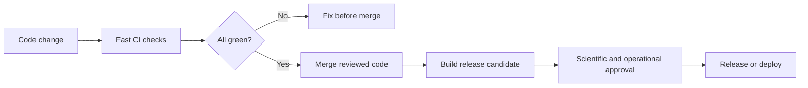
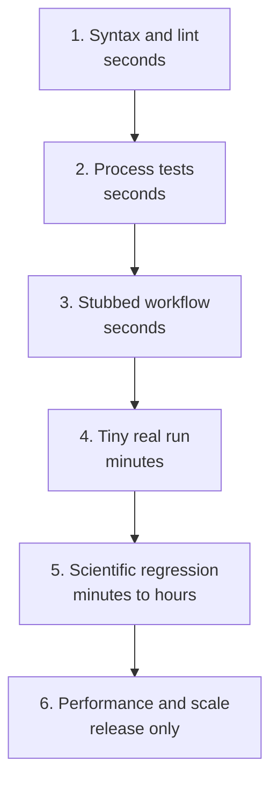
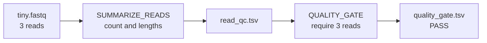

# Testing Nextflow Pipelines Scientists Can Trust

<div class="scenario-panel">
<p class="eyebrow">A biotech release is due Friday</p>
<p>A translational team reruns its Oxford Nanopore isoform pipeline before selecting targets for wet-lab validation. The workflow finishes successfully, but the transcript count has changed. Was the difference caused by new biology, a minimap2 parameter, an IsoQuant update, or a broken channel?</p>
<p><strong>A green exit code cannot answer that question. A layered test suite can catch the software change before it reaches the analysis team.</strong></p>
</div>

**Takeaway:** Test pipeline wiring quickly on every change, test real tools on tiny public data, and test biological expectations before releasing a result.

[Week 5](week-05-nextflow-nfcore-rnaseq.html) explained how Nextflow runs work. [Week 6](week-06-build-custom-nextflow-ont-pipeline.html) built an ONT workflow from FASTQ through IsoQuant and SQANTI3. This guide adds the safety system around that pipeline.

[Open the complete Week 7 project on GitHub](https://github.com/Caffeinated-Code/Bioinformatics_Field_Guide/tree/main/content/resources/week-07). It contains the sandbox, shared test script, GitHub Actions workflow, and Jenkinsfile used below.

## CI/CD In Plain Language

**Continuous integration (CI)** runs checks whenever code changes. It answers: *Can this change be merged without breaking behavior we already depend on?*

**Continuous delivery** prepares a tested release that a person can approve. For a bioinformatics pipeline, the release may contain a Git tag, container digest, checksums, documentation, and test reports.

**Continuous deployment** automatically places every passing change into a live environment. That can suit a low-risk internal service. It is usually too aggressive for scientific interpretation or a controlled production pipeline without additional approval and validation.



### The Useful Types Of CI

| CI type | Trigger | Good bioinformatics use |
|---|---|---|
| pull-request CI | every proposed change | lint code, run unit tests, test pipeline wiring |
| branch CI | merge to `main` | repeat fast tests and save reports |
| matrix CI | one change across several environments | test supported Nextflow, Java, or container profiles |
| scheduled CI | nightly or weekly | run real tools on a small public truth set and detect dependency drift |
| release CI | version tag | run the full validation set, build containers, create checksums and provenance |
| deployment pipeline | approved release | promote the same immutable image into an approved environment |

For most research groups, start with pull-request CI and release CI. Add scheduled tests when dependencies or external references can change.

## CI Is Not Scientific Validation

These questions are related, but they are not interchangeable:

| Question | Example check |
|---|---|
| Does the code parse? | `nextflow lint` reports no errors |
| Are processes connected correctly? | the five Week 6 tasks run in the expected order |
| Do commands run? | minimap2, IsoQuant, and SQANTI3 finish on tiny data |
| Are output contracts intact? | BAM, GTF, classification, and report files exist and are non-empty |
| Are results scientifically plausible? | known isoforms are recovered within reviewed tolerances |
| Is the change acceptable? | a scientist reviews changed metrics, assumptions, and evidence |

A pipeline can pass every software test and still use the wrong genome build, strandedness, contrast, or sample metadata. CI reduces preventable errors. It does not replace scientific review.

## Build A Test Ladder

Run cheap checks often. Reserve expensive tests for schedules and releases.



| Layer | What should fail the test? | When to run |
|---|---|---|
| syntax and lint | invalid syntax, deprecated constructs, malformed configuration | every change |
| process test | wrong command, input, output, or metadata contract | every change |
| stubbed workflow | broken channel or missing dependency between processes | every change |
| tiny integration | tool crash, missing container dependency, wrong published file | every change when fast; otherwise nightly |
| scientific regression | unexpected truth-set metric or changed biological result | nightly and release |
| performance regression | material increase in time, memory, retries, or cost | release and major tool updates |

## Which Testing Tools Matter?

`nf-test` is the most useful Nextflow-specific test framework, but it is not the whole toolbox.

| Tool | Best use | Limitation |
|---|---|---|
| `nextflow lint` | syntax, configuration, and deprecated Nextflow constructs | does not execute the pipeline |
| Nextflow `stub` and `-stub-run` | test dataflow without running heavy tools | fake outputs do not validate tool behavior |
| `nf-test` | process, workflow, pipeline, snapshot, and trace assertions | requires a designed test fixture and compatible Java runtime |
| Python `unittest` or `pytest` | inspect TSV, JSON, VCF, GTF, counts, and biological metrics | you must define meaningful assertions |
| `pytest-workflow` | generic command and file-based workflow tests | less Nextflow-aware than `nf-test` |
| Bash or Bats | small smoke tests and file contracts | becomes hard to maintain when assertions grow |
| `nf-core pipelines lint` | enforce nf-core structure and community conventions | most useful for nf-core-style repositories |
| Trivy or Grype | scan container images and dependencies | a clean scan does not prove analytical validity |

This project uses `nextflow lint`, Nextflow stubs, `nf-test`, Bash, and Python's standard-library `unittest`. There is no single magic test runner.

### Choose Test Data Deliberately

| Fixture | Purpose |
|---|---|
| tiny positive case | proves the expected path works |
| negative case | proves bad input or a failed QC gate is rejected |
| boundary case | tests the exact edge of a threshold, such as three versus four reads |
| public truth set | measures biological sensitivity, precision, or concordance |
| malformed input | checks that the error is early and understandable |

Never make a test dataset tiny by blindly taking the first few records. Preserve the feature that the test is meant to exercise: a splice junction, known isoform, variant, stranded read, low-quality sample, or metadata failure.

## GitHub Actions Or Jenkins?

Both tools automate commands. The main difference is where they run and who operates them.

| | GitHub Actions | Jenkins |
|---|---|---|
| strongest fit | public or GitHub-hosted projects | private biotech/pharma networks, on-premises systems, and custom HPC access |
| setup | fast; workflow YAML lives in `.github/workflows` | Jenkins controller, agents, plugins, credentials, and upgrades need ownership |
| runners | GitHub-hosted or self-hosted | self-hosted agents you control |
| pull-request experience | native checks and annotations | strong after source-control integration |
| customization | marketplace actions and containers | highly customizable agents and plugins |
| main risk | unsafe third-party actions or secrets on untrusted code | plugin drift, server maintenance, and inconsistent agents |

**Our choice:** GitHub Actions is the public reference implementation. Jenkins runs the same checks for teams that need private infrastructure. The tests do not change with the CI platform.

## Five-Minute Lab: Test Three FASTQ Reads

The sandbox contains three reads: 8, 12, and 16 bases long. The workflow counts them, calculates length metrics, and applies a minimum-read gate.



### 1. Run It

You need Nextflow, Java, Bash, and Python 3. Docker is not required.

```bash
# Download the public Field Guide repository.
git clone https://github.com/Caffeinated-Code/Bioinformatics_Field_Guide.git

# Enter the repository.
cd Bioinformatics_Field_Guide

# Run the tiny Nextflow pipeline and four scientific assertions.
bash content/resources/week-07/scripts/run_sandbox.sh
```

The important output is short:

```text
Ran 4 tests in 0.001s
OK

QC summary
metric          value
reads           3
bases           36
mean_length     12.0
min_length      8
max_length      16

Gate decision
metric          value
status          PASS
reads           3
minimum_reads   3
```

The Nextflow command proves that the processes run. The Python tests prove that the numbers and decision are correct.

### 2. Break It On Purpose

Raise the minimum from three reads to four:

```bash
# This is expected to fail because the FASTQ contains only three reads.
nextflow run content/resources/week-07/sandbox/main.nf \
  --reads content/resources/week-07/sandbox/data/tiny.fastq \
  --min_reads 4 \
  --outdir build/expected-failure \
  -work-dir build/failure-work \
  -ansi-log false
```

Expected message:

```text
QC failed: expected at least 4 reads, observed 3.
ERROR ~ Error executing process > 'QUALITY_GATE'
```

That red result is good. The gate rejected data that violated its contract. A useful test must fail when behavior is wrong.

## Test The Week 6 ONT Pipeline

The real workflow has five processes. FASTQ QC and alignment can begin in parallel:

```text
FASTQ -> FASTQ_QC
     \-> ALIGN_MINIMAP2 -> ALIGNMENT_QC
                        \-> ISOQUANT_DISCOVERY -> SQANTI3_ANNOTATION
```

Running all real tools on every edit would download a multi-gigabyte image and waste CI time. Each process therefore has a lightweight `stub` that creates correctly named stand-in outputs.

Here is the alignment stub:

```nextflow
stub:
"""
printf 'stub alignment for ${meta.id}\n' > ${meta.id}.sorted.bam
printf 'stub index for ${meta.id}\n' > ${meta.id}.sorted.bam.bai
"""
```

During a normal run, Nextflow executes the real minimap2 and samtools script. During `-stub-run`, it executes this block instead. Downstream processes receive the same filenames, so the dataflow can be tested without pretending the files contain real alignments.

The `nf-test` specification supplies tiny inputs and checks the execution trace:

```groovy
nextflow_pipeline {
  name "Week 6 ONT pipeline wiring"
  script "main.nf"

  test("runs all five stages with lightweight stubs") {
    options "-stub-run"

    when {
      params {
        input = "$baseDir/tests/data/samplesheet.csv"
        reference = "$baseDir/tests/data/tiny.fa"
        annotation = "$baseDir/tests/data/tiny.gtf"
        outdir = "$outputDir"
      }
    }

    then {
      assert workflow.success
      assert workflow.trace.tasks().size() == 5
      assert workflow.trace.failed().size() == 0
    }
  }
}
```

Run it locally:

```bash
# Enter the Week 6 pipeline project.
cd content/resources/week-06

# Create the report folder. nf-test will write JUnit XML here.
mkdir -p .test-results

# Run in CI mode so missing snapshots or failures stop the build.
nf-test test tests/pipeline.nf.test \
  --ci \
  --junitxml .test-results/nf-test.xml
```

Expected result:

```text
Week 6 ONT pipeline wiring
Test 'runs all five stages with lightweight stubs' PASSED
SUCCESS: Executed 1 tests
```

If nf-test reports `Unsupported class file major version`, check `java -version`. This project is tested with Java 17 and nf-test 0.9.3. A much newer Java runtime can be ahead of nf-test's bundled Groovy version.

### What The Fast Test Proves

- the samplesheet is parsed
- protocol metadata reaches alignment
- all five tasks are connected
- expected output names still exist
- no task fails

It does **not** prove that minimap2 aligned reads correctly or that IsoQuant discovered valid isoforms.

### Add Real Scientific Checks

Use the [public Week 6 IsoQuant dataset](week-06-build-custom-nextflow-ont-pipeline.html#run-the-verified-toy-project) for scheduled and release tests. With the pinned versions used in this guide, the verified run produced 439 primary alignments, 30 transcript models, and 30 SQANTI3 classification rows.

Treat those values as versioned expectations, not universal biological thresholds. If a reviewed tool update changes them, investigate the reason before updating the test.

For a production isoform pipeline, consider checking:

- expected control transcripts are recovered
- transcript and junction counts remain within reviewed tolerances
- genome build and annotation identifiers match
- structural-category proportions do not shift unexpectedly
- no sample disappears from the output
- runtime, peak memory, retries, and output size stay within a budget

Prefer stable assertions. Sort records before comparing them, ignore timestamps and temporary paths, and use reviewed numeric tolerances when exact equality is not scientifically meaningful. Snapshot changes should be inspected, not accepted automatically.

## One Command Everywhere

The shared entry point keeps local and hosted CI aligned:

```bash
# From the repository root: lint, run nf-test, run the sandbox, and validate results.
bash content/resources/week-07/scripts/run_fast_ci.sh
```

The script supports smaller targets too:

```bash
bash content/resources/week-07/scripts/run_fast_ci.sh lint
bash content/resources/week-07/scripts/run_fast_ci.sh contract
bash content/resources/week-07/scripts/run_fast_ci.sh sandbox
```

If this command fails locally, it should fail in GitHub Actions and Jenkins for the same reason.

## GitHub Actions: The Public Path

The repository workflow runs when Week 6 or Week 7 pipeline files change in a pull request or on `main`; it can also be started manually. It installs pinned tool versions, runs the shared script, and keeps reports even when a test fails.

```yaml
jobs:
  fast-tests:
    runs-on: ubuntu-latest
    timeout-minutes: 15

    steps:
      - uses: actions/checkout@v7

      - uses: nf-core/setup-nextflow@v3
        with:
          version: '26.04.2'
          java-version: '17'
          java-distribution: 'temurin'

      - uses: nf-core/setup-nf-test@v1
        with:
          version: '0.9.3'

      - name: Run the shared fast CI suite
        run: bash content/resources/week-07/scripts/run_fast_ci.sh

      - name: Keep reports and sandbox outputs
        if: always()
        uses: actions/upload-artifact@v7
        with:
          name: week-07-ci-results
          path: |
            build/test-results/
            build/sandbox/
```

[View the complete workflow](https://github.com/Caffeinated-Code/Bioinformatics_Field_Guide/blob/main/.github/workflows/week-07-pipeline-ci.yml), including path filters, read-only permissions, concurrency control, and manual execution.

For a regulated or security-sensitive repository, pin external actions to reviewed commit SHAs, restrict permissions, protect the release environment, and review dependency updates.

## Jenkins: The Private Infrastructure Path

Jenkins is useful when runners must reach an internal HPC cluster, private registry, controlled S3 bucket, or approved network that a public runner cannot access.

Store the pipeline definition as a `Jenkinsfile` in Git. Do not hide the build logic in a manually configured web form.

```groovy
pipeline {
  agent { label 'bioinformatics-ci' }

  options {
    timestamps()
    timeout(time: 15, unit: 'MINUTES')
    disableConcurrentBuilds(abortPrevious: true)
  }

  stages {
    stage('Environment') {
      steps { sh 'bash content/resources/week-07/scripts/run_fast_ci.sh versions' }
    }
    stage('Lint') {
      steps { sh 'bash content/resources/week-07/scripts/run_fast_ci.sh lint' }
    }
    stage('Pipeline contract') {
      steps { sh 'bash content/resources/week-07/scripts/run_fast_ci.sh contract' }
    }
    stage('Tiny FASTQ sandbox') {
      steps { sh 'bash content/resources/week-07/scripts/run_fast_ci.sh sandbox' }
    }
  }

  post {
    always {
      script {
        if (fileExists('build/test-results/nf-test.xml')) {
          junit testResults: 'build/test-results/nf-test.xml'
        }
        if (fileExists('build/sandbox/read_qc.tsv')) {
          archiveArtifacts artifacts: 'build/sandbox/**', fingerprint: true
        }
      }
    }
  }
}
```

The Jenkins agent labeled `bioinformatics-ci` needs Java 17, Nextflow 26.04.2, nf-test 0.9.3, Bash, and Python 3. The controller needs the Pipeline and JUnit plugins. Jenkins then records the test report and fingerprints the sandbox outputs for traceability.

## A Practical Pharma Test Schedule

| Stage | Data | Checks | Target time |
|---|---|---|---|
| every pull request | synthetic files committed to Git | lint, stubs, unit assertions, tiny sandbox | under 5 minutes |
| nightly | small public or approved de-identified dataset | real tools, containers, reference access, scientific metrics | under 1 hour |
| release candidate | locked validation set | concordance, reviewed tolerances, provenance, performance | project-specific |
| production promotion | no new analysis | verify approved image digest, config, release notes, and sign-off | minutes |

Keep protected data off public runners. Use synthetic or public fixtures for public CI. Run controlled datasets only on approved self-hosted infrastructure with least-privilege credentials, encryption, audit logging, and retention rules.

CI/CD can support an organization's validation process. It does not create regulatory compliance by itself.

## What Should A Release Preserve?

Save enough evidence to reconstruct both the software and the decision:

- Git commit and release tag
- exact Nextflow and nf-test versions
- immutable container image digest, not only a mutable tag
- parameter file and non-sensitive samplesheet schema
- reference genome and annotation release identifiers plus checksums
- JUnit, Nextflow trace, timeline, report, and DAG
- scientific acceptance metrics and approved tolerances
- changelog, reviewer, approval, and release date
- software bill of materials and security scan where required

Do not automatically publish biological conclusions because a build is green. Automate the evidence; keep accountable review at the decision point.

## Diagnose A Red Build

| Failure | First place to look | Typical fix |
|---|---|---|
| lint fails | named file and line | correct syntax or replace a deprecated construct |
| nf-test cannot find data | `baseDir`, samplesheet paths, staged fixtures | use repository-relative fixtures or explicit absolute test paths |
| class-file version error | `java -version` | use the supported Java LTS version |
| stub test fails | Nextflow trace and process outputs | repair channel shape, metadata, or output contract |
| sandbox fails | `.command.err` in the Nextflow work directory | fix the command or its runtime dependency |
| scientific assertion fails | metric diff and tool/reference versions | investigate first; update expectations only after review |
| CI passes locally only | printed versions and runner architecture | make environments explicit and remove hidden local dependencies |

## The Bookmark Checklist

- [ ] Every change runs fast CI.
- [ ] Tests can fail for a demonstrated reason.
- [ ] Workflow wiring is tested separately from real tools.
- [ ] Scientific assertions inspect content, not only file existence.
- [ ] Tiny fixtures are public, synthetic, or approved.
- [ ] Tool, Java, Nextflow, and container versions are explicit.
- [ ] GitHub Actions and Jenkins call the same local command.
- [ ] Slow truth-set tests run on a schedule and before release.
- [ ] Changed scientific expectations require review.
- [ ] Reports, provenance, and immutable artifacts are retained.

## Continue The Infrastructure Path

The earlier workflow-manager and AWS material is preserved as a [cloud execution companion](nextflow-workflow-tools-aws-companion.html). Week 8 will extend this infrastructure path into storage, metadata, orchestration, and batch-compute architecture for large biological datasets on AWS.

## Credits And References

- Forer L, Schönherr S. [Improving the reliability, quality, and maintainability of bioinformatics pipelines with nf-test](https://doi.org/10.1093/gigascience/giaf130). *GigaScience*. 2025.
- Di Tommaso P, Chatzou M, Floden EW, et al. [Nextflow enables reproducible computational workflows](https://doi.org/10.1038/nbt.3820). *Nature Biotechnology*. 2017.
- [nf-test documentation](https://www.nf-test.com/docs/)
- [Nextflow process stubs](https://www.nextflow.io/docs/latest/process.html#stub)
- [Nextflow CLI and lint documentation](https://www.nextflow.io/docs/latest/reference/cli.html)
- [GitHub Actions documentation](https://docs.github.com/en/actions)
- [nf-core setup-nextflow action](https://github.com/nf-core/setup-nextflow)
- [nf-core setup-nf-test action](https://github.com/nf-core/setup-nf-test)
- [GitHub checkout action](https://github.com/actions/checkout)
- [GitHub upload-artifact action](https://github.com/actions/upload-artifact)
- [Jenkins Pipeline documentation](https://www.jenkins.io/doc/book/pipeline/)
- [Jenkins test and artifact recording](https://www.jenkins.io/doc/pipeline/tour/tests-and-artifacts/)
- [nf-core pipeline linting](https://nf-co.re/docs/nf-core-tools/cli/pipelines/lint)
- [pytest-workflow documentation](https://pytest-workflow.readthedocs.io/en/stable/)
- [Trivy documentation](https://trivy.dev/latest/)
- [Grype documentation](https://oss.anchore.com/docs/overview/)
