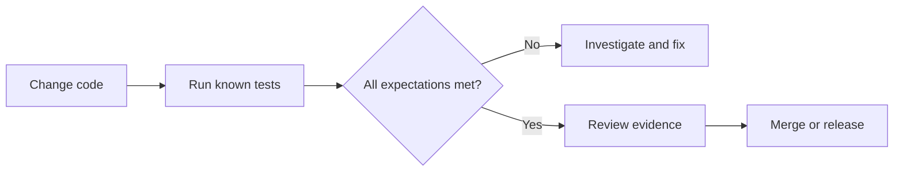
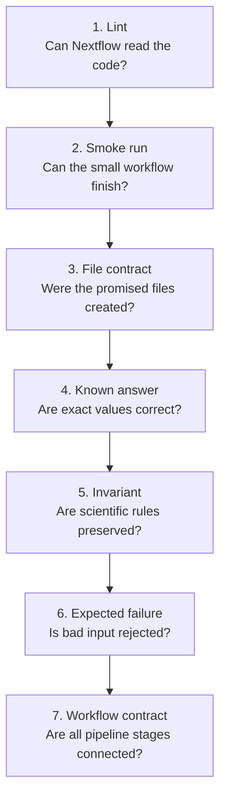
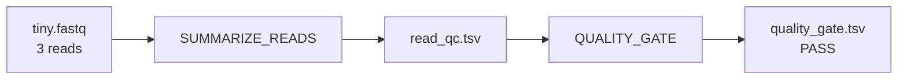

# CI/CD for Bioinformatics: Seven Tests That Keep Pipelines Honest

<div class="scenario-panel">
<p class="eyebrow">A biotech release is due Friday</p>
<p>A translational team reruns its Oxford Nanopore isoform pipeline before choosing targets for wet-lab validation. The workflow finishes, but the transcript count has changed. Did the biology change, or did a parameter, tool version, channel, or output format change?</p>
<p><strong>A completed workflow cannot answer that question. Tests can show exactly which expectation changed before the result reaches the analysis team.</strong></p>
</div>

**Takeaway:** A good bioinformatics test suite checks code, files, known answers, scientific rules, failure paths, and workflow wiring. CI simply runs those checks automatically whenever the code changes.

[Week 5](week-05-nextflow-nfcore-rnaseq.html) introduced Nextflow. [Week 6](week-06-build-custom-nextflow-ont-pipeline.html) built an ONT pipeline from FASTQ through IsoQuant and SQANTI3. This guide puts a safety system around that project.

[Open the complete Week 7 project on GitHub](https://github.com/Caffeinated-Code/Bioinformatics_Field_Guide/tree/main/content/resources/week-07). Every command and expected result below comes from that repository.

## First, Five Words You Need

| Term | Plain-language meaning |
|---|---|
| **fixture** | a small, known input used only for testing |
| **test** | a question about what the code should do |
| **assertion** | the exact condition that must be true |
| **regression** | behavior that worked before but changed unexpectedly |
| **test suite** | a group of tests run together |

For example, this article's fixture is a FASTQ file with three reads. One assertion says the total number of bases must be `36`. If a code change produces `35`, the test fails and reports the mismatch.

**Continuous integration (CI)** means running the test suite automatically for each proposed change. **Continuous delivery (CD)** means preparing a passing version for release. Continuous deployment goes one step further and releases automatically; scientific pipelines usually retain a human approval step.



The important idea is not the automation platform. It is the set of questions you ask before trusting a change.

## A Five-Minute First Win

You need Nextflow, Java, Bash, and Python 3. Docker and biological software are not required for this sandbox.

```bash
# Download the public Field Guide repository.
git clone https://github.com/Caffeinated-Code/Bioinformatics_Field_Guide.git

# Move into the downloaded project.
cd Bioinformatics_Field_Guide

# Run the tiny pipeline, inspect its files, and test its results.
bash content/resources/week-07/scripts/run_sandbox.sh
```

The fixture contains reads of 12, 8, and 16 bases. Therefore, a correct result has 3 reads, 36 total bases, a mean length of 12, a minimum of 8, and a maximum of 16.

```text
File contract: PASS (two non-empty TSV files with metric/value headers)

Ran 6 tests in 0.002s
OK

QC summary
metric          value
reads           3
bases           36
mean_length     12.0
min_length      8
max_length      16

Gate decision
metric          value
status          PASS
reads           3
minimum_reads   3
```

You have just run a Nextflow integration test, a file-contract test, and six Python assertions. Now let us separate those layers and see what each one protects.

## The Seven Tests You Will Reuse



### 1. Lint Test: Catch Invalid Nextflow Early

**Question:** Can Nextflow parse the scripts and configuration?

**Use it:** On every edit and pull request. It is fast and catches syntax errors, deprecated constructs, and style problems before a workflow starts.

```bash
# Examine every Nextflow file in the Week 6 project without running the pipeline.
nextflow lint content/resources/week-06
```

Expected final output:

```text
Nextflow linting complete!
8 files had no errors
```

If it fails, Nextflow names the file and issue. Fix lint errors first; downstream tests are harder to interpret when the code cannot be parsed.

### 2. Smoke Test: Prove A Tiny Workflow Can Finish

**Question:** Can representative input travel through the main path without a process crashing?

**Use it:** On every pull request when it takes seconds or a few minutes. Use a scheduled job if the smallest meaningful run is still expensive.

The sandbox sends one FASTQ through two processes:



```bash
# Run the small end-to-end path and all checks attached to it.
bash content/resources/week-07/scripts/run_sandbox.sh
```

These lines prove both processes were scheduled and completed:

```text
Submitted process > SUMMARIZE_READS (tiny)
Submitted process > QUALITY_GATE (1)
```

A smoke test answers "did it run?" It does not yet prove that every result is correct. That is why the next tests inspect the outputs.

### 3. File-Contract Test: Check What The Pipeline Promised

**Question:** Do the required outputs exist, contain data, and use the expected basic format?

**Use it:** After every process that hands a file to another process, tool, or analyst. File contracts catch renamed outputs, empty files, and changed headers.

This Bash loop checks both sandbox TSV files:

```bash
for result_file in read_qc.tsv quality_gate.tsv; do
  result_path="${outdir}/${result_file}"

  # -s is true only when the file exists and is not empty.
  [[ -s "${result_path}" ]] || exit 1

  # Confirm the first line is the two-column schema expected downstream.
  [[ "$(head -n 1 "${result_path}")" == $'metric\tvalue' ]] || exit 1
done
```

Expected output:

```text
File contract: PASS (two non-empty TSV files with metric/value headers)
```

For BAM, add `samtools quickcheck`; for VCF, use `bcftools view -h`; for JSON, parse it instead of searching raw text. A file merely existing is the weakest useful contract.

### 4. Known-Answer Test: Check Exact Values

**Question:** Does known input produce the known answer?

**Use it:** For deterministic parsing, transformations, counts, coordinate conversion, filters, and calculations. Keep fixtures small enough that you can verify the expected answer by hand.

Python's built-in `unittest` discovers functions whose names begin with `test_`. Each assertion states one expectation:

```python
def test_required_metrics(self) -> None:
    # The output must contain exactly these five metric names.
    self.assertSetEqual(
        set(self.qc),
        {"reads", "bases", "mean_length", "min_length", "max_length"},
    )

def test_read_count(self) -> None:
    # The fixture was designed with exactly three reads.
    self.assertEqual(int(self.qc["reads"]), 3)

def test_total_bases(self) -> None:
    # Read lengths 12 + 8 + 16 must total 36 bases.
    self.assertEqual(int(self.qc["bases"]), 36)
```

Expected output:

```text
test_read_count (...) ... ok
test_required_metrics (...) ... ok
test_total_bases (...) ... ok
```

If `reads` becomes `4`, `assertEqual` reports the observed and expected values. That message is much more useful than discovering a changed table days later.

### 5. Invariant Test: Protect A Rule, Not One Dataset

**Question:** Is a relationship that should always hold still true?

**Use it:** When exact outputs may vary across valid tool versions but scientific or mathematical rules must remain true.

The mean read length must lie between the shortest and longest read:

```python
def test_lengths_are_ordered(self) -> None:
    minimum = int(self.qc["min_length"])
    mean = float(self.qc["mean_length"])
    maximum = int(self.qc["max_length"])

    # This relationship should hold for any non-empty FASTQ, not only our fixture.
    self.assertLessEqual(minimum, mean)
    self.assertLessEqual(mean, maximum)
```

The QC decision has its own invariant:

```python
def test_quality_gate(self) -> None:
    self.assertEqual(self.gate["status"], "PASS")
    self.assertGreaterEqual(
        int(self.gate["reads"]), int(self.gate["minimum_reads"])
    )
```

Expected output:

```text
test_lengths_are_ordered (...) ... ok
test_quality_gate (...) ... ok
```

Useful bioinformatics invariants include `0 <= allele_frequency <= 1`, every sample in the samplesheet appears in the report, genomic intervals have `start < end`, and paired files share the same sample identifier.

### 6. Expected-Failure Test: Make Sure Bad Input Stops

**Question:** Does the pipeline fail for the right reason when an acceptance rule is violated?

**Use it:** For malformed samplesheets, reference mismatches, missing metadata, unsupported protocols, empty results, and QC boundaries.

Our positive test requires at least three reads. The negative test deliberately raises the requirement to four while keeping the same three-read fixture:

```bash
# This wrapper passes only when the inner Nextflow run fails as expected.
bash content/resources/week-07/scripts/test_expected_failure.sh
```

Expected output:

```text
Expected-failure test: PASS
QC failed: expected at least 4 reads, observed 3.
```

The wrapper checks two things: Nextflow returned a non-zero exit status, and the log contains the exact QC message. A random crash therefore cannot masquerade as the expected rejection.

This is a particularly valuable trick: **test the test**. Run one example that should pass and a neighboring example that should fail.

### 7. Workflow-Contract Test: Check A Larger Pipeline Cheaply

**Question:** Are all processes, channels, metadata, and output names still connected?

**Use it:** For multi-process Nextflow workflows where running every real bioinformatics tool on every edit would be slow or costly.

The Week 6 ONT workflow has five processes. FASTQ QC and alignment can begin in parallel:

```text
FASTQ -> FASTQ_QC
     \-> ALIGN_MINIMAP2 -> ALIGNMENT_QC
                        \-> ISOQUANT_DISCOVERY -> SQANTI3_ANNOTATION
```

Each process has a Nextflow `stub` that creates lightweight stand-in outputs. `nf-test` runs those stubs and inspects the execution trace:

```groovy
test("runs all five stages with lightweight stubs") {
  options "-stub-run"                 // Skip expensive biological commands.

  when {
    params {
      input = "$baseDir/tests/data/samplesheet.csv"
      reference = "$baseDir/tests/data/tiny.fa"
      annotation = "$baseDir/tests/data/tiny.gtf"
      outdir = "$outputDir"
    }
  }

  then {
    assert workflow.success                         // The workflow completed.
    assert workflow.trace.tasks().size() == 5       // All five tasks ran.
    assert workflow.trace.failed().size() == 0      // No task failed.
  }
}
```

Run the contract test:

```bash
# Run only the Week 6 nf-test contract from the repository root.
bash content/resources/week-07/scripts/run_fast_ci.sh contract
```

Expected output:

```text
Test 'runs all five stages with lightweight stubs' PASSED
SUCCESS: Executed 1 tests
```

This proves the workflow is wired correctly. It does **not** prove that minimap2 aligned reads correctly or that IsoQuant discovered valid isoforms. Stubs test plumbing, not biology.

## Add Scientific Regression Tests Next

Software checks answer whether the pipeline behaves as designed. Scientific regression tests ask whether a reviewed biological result changed.

The [Week 6 public-data tutorial](week-06-build-custom-nextflow-ont-pipeline.html#run-the-verified-toy-project) produced 439 primary alignments, 30 transcript models, and 30 SQANTI3 classification rows with the pinned tool versions. A scheduled test could compare a new run with those versioned expectations.

Good scientific checks might ask:

- Were expected control transcripts recovered?
- Did transcript or splice-junction counts move outside reviewed tolerances?
- Do genome and annotation identifiers match?
- Did a sample disappear between input and report?
- Did structural-category proportions shift unexpectedly?
- Did runtime or peak memory change materially?

Do not blindly compare whole files byte for byte. Sort records, ignore timestamps and temporary paths, and use reviewed tolerances when exact equality has no scientific meaning. When an expected metric changes after a legitimate tool update, investigate and document why before changing the test.

## Decide When Each Test Runs

Fast feedback and deep validation serve different moments:

| Trigger | Run | Why |
|---|---|---|
| while coding | one focused test | get an answer in seconds |
| every pull request | lint, unit, file, negative, and stub tests | block obvious regressions before merge |
| nightly or weekly | real tools on small public or approved data | detect dependency, container, and reference drift |
| release candidate | scientific metrics, provenance, performance, security | create evidence for a reviewed release |

Tiny data must still be meaningful. Preserve the feature the test is meant to exercise, such as a splice junction, known isoform, stranded read, low-quality sample, or metadata error. Taking the first ten records from a large file rarely creates a good fixture.

## One Command On A Laptop Or In CI

The complete fast suite has one entry point:

```bash
# Print versions, lint Week 6, run nf-test, test the sandbox,
# and confirm that the QC gate rejects its negative case.
bash content/resources/week-07/scripts/run_fast_ci.sh
```

You can run one layer while developing:

```bash
bash content/resources/week-07/scripts/run_fast_ci.sh lint
bash content/resources/week-07/scripts/run_fast_ci.sh contract
bash content/resources/week-07/scripts/run_fast_ci.sh sandbox
bash content/resources/week-07/scripts/run_fast_ci.sh negative
```

If the same script runs locally and in CI, debugging is simpler. The automation service should call your tests, not hide a second copy of them.

## Automate It Without Learning Two Platforms

Think of CI as another computer that checks out the repository and runs the command above from a clean environment.

This project's GitHub Actions workflow installs pinned versions, runs the shared suite, and uploads the reports even if a test fails:

```yaml
steps:
  - uses: actions/checkout@v7       # Download this commit onto the runner.

  - uses: nf-core/setup-nextflow@v3 # Install the tested Nextflow and Java versions.
    with:
      version: '26.04.2'
      java-version: '17'
      java-distribution: 'temurin'

  - uses: nf-core/setup-nf-test@v1  # Install the tested nf-test version.
    with:
      version: '0.9.3'

  - name: Run the shared fast CI suite
    run: bash content/resources/week-07/scripts/run_fast_ci.sh

  - name: Keep reports for debugging
    if: always()                    # Upload evidence even after a failed test.
    uses: actions/upload-artifact@v7
```

[Read the complete GitHub Actions workflow](https://github.com/Caffeinated-Code/Bioinformatics_Field_Guide/blob/main/.github/workflows/week-07-pipeline-ci.yml). It also uses read-only permissions, path filters, a timeout, and concurrency control.

You do not need both GitHub Actions and Jenkins:

| Start with | Choose it when | Tradeoff |
|---|---|---|
| **GitHub Actions** | the project is on GitHub and can use GitHub-hosted or self-hosted runners | fastest setup; review third-party actions and permissions |
| **Jenkins** | jobs must reach an internal HPC cluster, private registry, or controlled network already served by Jenkins agents | highly flexible; your team owns the controller, plugins, credentials, and agents |

Both should run the same repository script. The [complete Jenkinsfile](https://github.com/Caffeinated-Code/Bioinformatics_Field_Guide/blob/main/content/resources/week-07/Jenkinsfile) is included for teams that need the private-infrastructure path.

Never put protected patient data or production credentials on a public runner. Use synthetic or public fixtures there; keep controlled datasets on approved infrastructure.

## Seven Small CI Tricks Worth Stealing

1. **Start every Bash test script with `set -euo pipefail`.** It stops on failed commands, unset variables, and failed commands hidden inside pipes.
2. **Print tool versions first.** A version difference often explains a local-versus-CI failure.
3. **Use exact, helpful failure messages.** Tests should tell the next person what contract was violated.
4. **Test both sides of a threshold.** A gate that passes good data but also accepts bad data is not working.
5. **Save JUnit reports and small outputs.** They turn a red status into inspectable evidence.
6. **Make output comparisons deterministic.** Sort unordered records and remove timestamps before comparing.
7. **Pin releases, preserve digests.** Tags can move; container digests and checksums identify the exact artifact tested.

## When Green Does Not Mean Correct Biology

A pipeline can pass every software test and still use the wrong genome build, annotation release, strandedness, contrast, or sample metadata. CI reduces preventable software errors; it does not replace scientific review.

Before release, preserve enough evidence to reconstruct the analysis:

- Git commit and release tag
- Nextflow, nf-test, and tool versions
- immutable container digest
- parameters and non-sensitive samplesheet schema
- reference and annotation identifiers plus checksums
- JUnit, trace, timeline, report, and DAG files
- scientific acceptance metrics and reviewed tolerances
- changelog, reviewer, and approval date

Automate evidence collection. Keep an accountable human at the scientific decision point.

## If A Test Turns Red

| Failure | Look here first | Likely action |
|---|---|---|
| lint error | named file and line | fix syntax or a deprecated construct |
| missing output | process log and `output:` declaration | repair the command, filename, or channel |
| wrong exact value | assertion diff | inspect parsing, filtering, and fixture assumptions |
| invariant failure | observed metrics | investigate impossible or unexpected relationships |
| negative test passes | validation condition and exit code | make the pipeline reject invalid input |
| nf-test contract fails | execution trace | repair channels, metadata, or process dependencies |
| CI only fails remotely | printed versions and runner architecture | remove hidden local dependencies and pin environments |

Do not immediately update an expected value to make CI green. First decide whether the code is wrong, the fixture is wrong, or the intended behavior truly changed.

## The Bookmark Checklist

- [ ] A new contributor can run the suite with one command.
- [ ] Fast tests run on every pull request.
- [ ] At least one known-answer test checks file content.
- [ ] At least one invariant protects a general rule.
- [ ] A negative test proves invalid input is rejected.
- [ ] Workflow wiring is tested separately from real tool behavior.
- [ ] Slow public-data tests run on a schedule and before release.
- [ ] Tool, Java, Nextflow, reference, and container versions are explicit.
- [ ] Reports and small failed-run artifacts are retained.
- [ ] Changed scientific expectations require review.

## Continue The Infrastructure Path

The workflow-manager and AWS material is preserved as a [cloud execution companion](nextflow-workflow-tools-aws-companion.html). Week 8 extends this infrastructure path into storage, metadata, orchestration, and batch-compute architecture for large biological datasets on AWS.

## Credits And References

- Forer L, Schoenherr S. [Improving the reliability, quality, and maintainability of bioinformatics pipelines with nf-test](https://doi.org/10.1093/gigascience/giaf130). *GigaScience*. 2025.
- Di Tommaso P, Chatzou M, Floden EW, et al. [Nextflow enables reproducible computational workflows](https://doi.org/10.1038/nbt.3820). *Nature Biotechnology*. 2017.
- [nf-test documentation](https://www.nf-test.com/docs/)
- [Nextflow process stubs](https://www.nextflow.io/docs/latest/process.html#stub)
- [Nextflow CLI and lint documentation](https://www.nextflow.io/docs/latest/reference/cli.html)
- [Python `unittest` documentation](https://docs.python.org/3/library/unittest.html)
- [GitHub Actions documentation](https://docs.github.com/en/actions)
- [GitHub Actions security guidance](https://docs.github.com/en/actions/security-for-github-actions/security-guides/security-hardening-for-github-actions)
- [Jenkins Pipeline documentation](https://www.jenkins.io/doc/book/pipeline/)
- [nf-core pipeline linting](https://nf-co.re/docs/nf-core-tools/cli/pipelines/lint)
