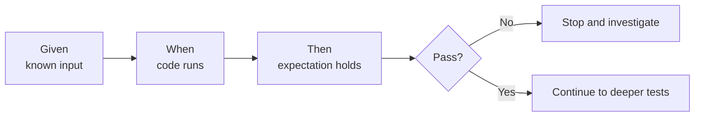
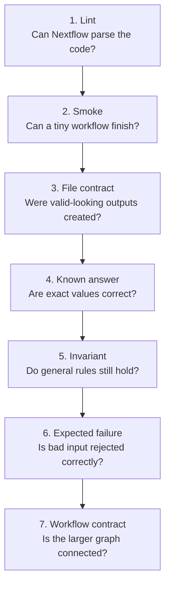
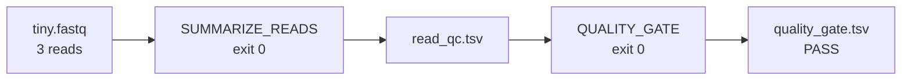
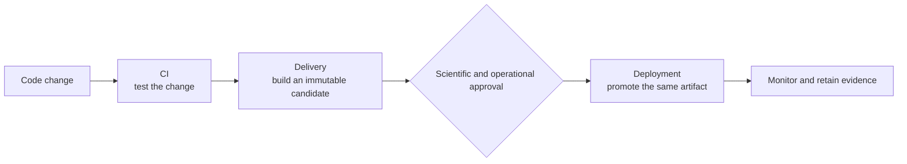

# CI/CD for Reliable Bioinformatics Pipelines

<div class="scenario-panel">
<p class="eyebrow">A biotech release is due Friday</p>
<p>A translational team reruns its Oxford Nanopore isoform pipeline before choosing targets for wet-lab validation. The workflow finishes, but the transcript count changed. Was it the biology? A parameter? A tool update? A missing sample?</p>
<p><strong>A completed run is not proof of a correct result. Tests show what changed before that result reaches the laboratory.</strong></p>
</div>

**Takeaway:** Start with one tiny input whose answer you know. Check that the workflow runs, creates the right files, returns the right values, and rejects bad input. Then let CI run those checks for every code change.

[Week 5](week-05-nextflow-nfcore-rnaseq.html) introduced Nextflow. [Week 6](week-06-build-custom-nextflow-ont-pipeline.html) built an ONT workflow from FASTQ through IsoQuant and SQANTI3. This guide makes that workflow safer to change and release.

[Open the complete Week 7 project on GitHub](https://github.com/Caffeinated-Code/Bioinformatics_Field_Guide/tree/main/content/resources/week-07). The sandbox, test files, passing and failing examples, GitHub Actions workflow, and Jenkinsfile are all public.

## The Mental Model Before The Code

| Term | Meaning in this guide |
|---|---|
| **fixture** | a small input used for testing; here, a three-read FASTQ |
| **test** | one question about what the code should do |
| **assertion** | one condition that must be true |
| **exit code** | `0` means a command succeeded; non-zero means it failed |
| **test harness** | a script that runs the test and checks its result |
| **regression** | a result that changed after the code or software changed |
| **CI** | run tests automatically when code changes |
| **CD** | prepare and promote a tested, versioned release |

A test can be read as a sentence:

> Given this known input, when this code runs, then this specific result must be true.



You decide what is correct. CI is simply another computer that checks those decisions every time the code changes.

## A Five-Minute First Win

### Clone Both Weeks In One Step

The Week 7 sandbox is self-contained. The later lint and nf-test examples inspect the Week 6 pipeline, so the complete exercise needs both directories.

They are already part of the same repository. **Clone once; do not clone Week 6 inside Week 7.** A nested clone would create the wrong paths.

```bash
# Clone the complete Field Guide. This downloads both Week 6 and Week 7.
git clone https://github.com/Caffeinated-Code/Bioinformatics_Field_Guide.git

# Enter the repository root. Run the remaining commands from here.
cd Bioinformatics_Field_Guide

# Confirm that both required projects are in their expected sibling locations.
ls content/resources/week-06/main.nf \
   content/resources/week-07/sandbox/main.nf
```

Expected output:

```text
content/resources/week-06/main.nf
content/resources/week-07/sandbox/main.nf
```

For the first win, you need Nextflow, Java, Bash, and Python 3. You do not need Docker, nf-test, minimap2, IsoQuant, or SQANTI3 yet.

```bash
# Run a real two-process Nextflow workflow, inspect its files, and test values.
bash content/resources/week-07/scripts/run_sandbox.sh
```

Expected final output:

```text
File contract: PASS (two non-empty TSV files with metric/value headers)

Ran 6 tests in 0.001s
OK

QC summary
metric          value
reads           3
bases           36
mean_length     12.0
min_length      8
max_length      16

Gate decision
metric          value
status          PASS
reads           3
minimum_reads   3
```

### What Did That One Command Actually Run?

`run_sandbox.sh` is the **test harness**. It runs three layers in order:

```bash
# Layer 1: run the Nextflow workflow on the known three-read FASTQ.
nextflow run "${resource_dir}/sandbox/main.nf" \
  --reads "${resource_dir}/sandbox/data/tiny.fastq" \
  --min_reads 3 \
  --outdir "${outdir}" \
  -work-dir "${workdir}" \
  -ansi-log false

# Layer 2: inspect the two files Nextflow published.
for result_file in read_qc.tsv quality_gate.tsv; do
  # The full loop checks file size and the metric/value header.
  result_path="${outdir}/${result_file}"
done

# Layer 3: discover and run every test_*.py file against those results.
QC_RESULTS="${outdir}" python3 -m unittest discover \
  -s "${resource_dir}/sandbox/tests" \
  -p 'test_*.py' \
  -v
```

This block is an execution map, not a replacement for the documented source file. The next seven sections open each exact check, explain what makes it pass, and show how it fails. [Read the complete wrapper](https://github.com/Caffeinated-Code/Bioinformatics_Field_Guide/blob/main/content/resources/week-07/scripts/run_sandbox.sh).

The fixture contains read lengths of 12, 8, and 16 bases. You can verify its expected answers without software: `3` reads, `36` bases, mean length `12`, minimum `8`, and maximum `16`.

## Seven Tests You Can Reuse



### 1. Lint: Read The Code Without Running It

**Real-life situation:** You edit a Nextflow process and forget one closing brace. Without linting, the job may wait in an HPC queue before it fails. That wastes time and compute.

**What this test does:** Linting reads the code without running the pipeline. Think of it as a grammar check for Nextflow scripts and configuration files.

```bash
# Parse every Nextflow script and configuration file in Week 6.
nextflow lint content/resources/week-06
```

Expected output:

```text
Nextflow linting complete!
8 files had no errors
```

If the final `}` is missing from a workflow, the real linter output is concise:

```text
Error main.nf:14:1: Unexpected input: '<EOF>'

Nextflow linting complete!
1 file had 1 error
```

`<EOF>` means "end of file." Nextflow reached the last line while it was still waiting for more code.

| Lint can catch | Lint cannot prove |
|---|---|
| missing braces or invalid syntax | minimap2 can align the reads |
| malformed configuration | a reference and annotation use the same build |
| deprecated or suspicious constructs | output values are biologically correct |
| some style and code-quality issues | the workflow has enough memory at scale |

Run lint before every commit. It is fast, and it removes simple syntax errors before deeper tests begin.

### 2. Smoke Test: Run The Smallest Meaningful Path

**Real-life situation:** A container was updated or a new process was added. Before running 300 samples, you need to know whether one tiny sample can still travel through the main workflow.

**What this test does:** A smoke test runs the smallest useful path from input to output. It answers one question: **can the workflow finish without crashing?**

The sandbox runs this real path:



The wrapper uses the `nextflow run` command from the first-win section. Nextflow runs `SUMMARIZE_READS` first. When its metrics file is ready, Nextflow sends that file to `QUALITY_GATE`.

These log lines confirm both tasks were submitted:

```text
Submitted process > SUMMARIZE_READS (tiny)
Submitted process > QUALITY_GATE (1)
```

#### How Does The Smoke Test Know It Failed?

Every shell command returns an **exit code**. `0` means success. Any other number means failure. The wrapper uses `set -euo pipefail`, so an unexpected failure stops the test immediately.

| Failure | Inner status | What the reader sees |
|---|---:|---|
| required command is missing | `127` from the harness | `nextflow is required but was not found on PATH` |
| FASTQ path does not exist | non-zero from Nextflow | no file matches the requested path |
| FASTQ contains no reads | `2` from the task's `awk` command | `SUMMARIZE_READS` terminates with an error |
| three reads are asked to satisfy a four-read gate | `1` from `QUALITY_GATE` | the explicit QC failure message |
| process exits `0` but omits a declared output | Nextflow marks the task failed | `Missing output file(s)` |

When a process fails, Nextflow also returns a non-zero code to CI. The task log keeps the more specific process code. The basic rule is simple: **zero continues; non-zero stops**.

A smoke test proves that the path can run. It does not prove that the output is correct. The next tests check the files and values.

### 3. File Contract: Follow The Channel And Check The Handoff

**Real-life situation:** A tool update changes `read_qc.tsv` to `read_metrics.tsv`, or renames the `metric` column. The upstream process finishes, but the downstream step can no longer read its output.

**What this test does:** A file contract checks what one process promises to give the next process. It can check the filename, format, columns, and whether the file contains data.

Start with the exact Nextflow wiring:

```nextflow
output:
// SUMMARIZE_READS must create this file and names its output channel "metrics".
path 'read_qc.tsv', emit: metrics

workflow {
  // Emit the FASTQ path once. checkIfExists fails early when the path is wrong.
  reads_ch = channel.fromPath(params.reads, checkIfExists: true)

  // The producer consumes the FASTQ path.
  SUMMARIZE_READS(reads_ch)

  // The consumer waits for the producer's named metrics output.
  QUALITY_GATE(SUMMARIZE_READS.out.metrics)
}
```

A **channel** moves data between Nextflow processes. In this example, it carries a file path:

1. `reads_ch` emits the FASTQ path.
2. `SUMMARIZE_READS` receives that path through `input: path reads`.
3. The process writes `read_qc.tsv` in its own work directory.
4. `output: path 'read_qc.tsv', emit: metrics` checks that the file exists and sends it onward.
5. `QUALITY_GATE` receives that emitted file through `input: path metrics`.
6. `publishDir` copies successful outputs from `work/` into the result folder.

Nextflow checks the declared filename. The Bash wrapper then checks that the file is not empty and has the expected header:

```bash
for result_file in read_qc.tsv quality_gate.tsv; do
  result_path="${outdir}/${result_file}"

  # Fail when the promised file is missing or contains zero bytes.
  if [[ ! -s "${result_path}" ]]; then
    printf 'File contract failed: %s is missing or empty.\n' "${result_path}" >&2
    exit 1
  fi

  # Fail when the first line is not exactly metric<TAB>value.
  if [[ "$(head -n 1 "${result_path}")" != $'metric\tvalue' ]]; then
    printf 'File contract failed: %s has the wrong header.\n' "${result_path}" >&2
    exit 1
  fi
done

# This line is reached only when every check above succeeded.
printf 'File contract: PASS (two non-empty TSV files with metric/value headers)\n'
```

Nextflow does not print the `PASS` message. The wrapper prints it only after both files pass every check.

| Breakage | Which layer catches it? |
|---|---|
| `read_qc.tsv` is never created | Nextflow output declaration |
| a channel sends no file to the consumer | Nextflow workflow execution |
| the published file is empty | `[[ ! -s ... ]]` in Bash |
| `metric` is renamed to `measure` | Bash header comparison |
| header is correct but `bases` is wrong | Python known-answer test |

Use a format-aware check when possible. Use `samtools quickcheck` for BAM, `bcftools` for VCF, and a JSON parser for JSON. A file can exist and still be broken.

### 4. Known-Answer Test: Turn One Fact Into Code

**Real-life situation:** You change a read filter. The workflow still finishes, but it now reports `35` bases instead of the correct answer, `36`. A smoke test will not catch this because nothing crashed.

**What this test does:** A known-answer test uses a tiny input whose correct result you can calculate by hand. It compares the pipeline's answer with your answer.

Python's `unittest` is the test framework used here. A pure unit test checks one isolated function. This example checks a completed pipeline output, so it is a known-answer output test. Both use the same assertions.

This is the core structure from `test_qc.py`:

```python
class TestTinyFastqQualityGate(unittest.TestCase):
    @classmethod
    def setUpClass(cls) -> None:
        # Load the result once and share it with every test method.
        cls.qc = read_metrics(RESULTS / "read_qc.tsv")

    def test_total_bases(self) -> None:
        # Actual value from the pipeline should equal our hand-calculated answer.
        self.assertEqual(int(self.qc["bases"]), 36)
```

#### Read It One Piece At A Time

| Code | Meaning |
|---|---|
| `class TestTinyFastqQualityGate(...)` | groups related tests under one readable name |
| `unittest.TestCase` | gives the class assertion methods such as `assertEqual` |
| `setUpClass` | prepares shared data once before the tests run |
| `cls` | the test class itself; `cls.qc` becomes available to every test object |
| `def test_total_bases` | a discoverable test; `unittest` looks for names beginning with `test_` |
| `self` | the current test object; it provides `self.qc` and `self.assertEqual(...)` |
| `-> None` | a type hint saying the function returns no value |
| `int(...)` | converts the TSV string `"36"` into the number `36` |
| `assertEqual(actual, expected)` | passes when both values match; raises an assertion failure otherwise |

The test does not return `True`. It passes when it reaches the end without an error. If an assertion is false, `unittest` reports the mismatch.

#### A Five-Step Recipe For Your Own Test

1. **Choose one behavior.** Example: total bases are calculated correctly.
2. **Create the smallest useful fixture.** Three reads are enough here.
3. **Calculate the answer independently.** `12 + 8 + 16 = 36`.
4. **Read the program's output.** Here, `self.qc["bases"]`.
5. **Write one focused assertion.** Compare the observed number with `36`.

Useful `unittest` assertions:

| Assertion | Use it for |
|---|---|
| `assertEqual(actual, expected)` | exact counts, names, strings, or dictionaries |
| `assertAlmostEqual(actual, expected, places=3)` | floating-point calculations |
| `assertSetEqual(actual, expected)` | fields where order should not matter |
| `assertGreaterEqual(actual, minimum)` | thresholds |
| `assertIn(item, collection)` | required sample, field, or category |
| `assertRaises(ErrorType)` | code that should reject invalid input |

If the pipeline reports `35` bases, `unittest` points to the exact assertion:

```text
FAIL: test_total_bases (test_qc.TestTinyFastqQualityGate.test_total_bases)
AssertionError: 35 != 36

Ran 6 tests in 0.001s
FAILED (failures=1)
```

One wrong value now creates one clear failure. To make this a pure unit test, move the base-counting calculation into a function. Then call that function directly with the three known sequences, without running Nextflow.

#### Quick Check: Write The Next Test

Suppose a fixture contains reads of 4, 6, and 10 bases. The program writes `mean_length` rounded to one decimal place. What assertion would you write?

<details>
<summary>Show the answer</summary>

The expected mean is `(4 + 6 + 10) / 3 = 6.666...`, reported as `6.7`.

```python
def test_mean_length(self) -> None:
    self.assertEqual(float(self.qc["mean_length"]), 6.7)
```

For calculations that are not deliberately rounded in the output, prefer `assertAlmostEqual` and state the precision.
</details>

### 5. Invariant Test: Protect A Rule That Should Always Hold

**Real-life situation:** Transcript counts may change slightly after a valid tool update. You may not know the exact new count. You still know that an allele frequency cannot be above `1`, an interval must have `start < end`, and a report cannot say `PASS` when its threshold failed.

**What this test does:** An invariant protects a rule that should always be true. It can catch impossible output even when you do not know the exact answer.

| Test | Example |
|---|---|
| known answer | this three-read fixture has exactly `36` bases |
| invariant | minimum length must be less than or equal to mean length, which must be less than or equal to maximum length |

```python
def test_lengths_are_ordered(self) -> None:
    minimum = int(self.qc["min_length"])
    mean = float(self.qc["mean_length"])
    maximum = int(self.qc["max_length"])

    self.assertLessEqual(minimum, mean)
    self.assertLessEqual(mean, maximum)
```

The QC table has another rule. If it says `PASS`, the read count must meet the minimum. A table with `PASS`, `reads = 2`, and `minimum_reads = 3` contradicts itself.

```python
def test_quality_gate(self) -> None:
    self.assertEqual(self.gate["status"], "PASS")
    self.assertGreaterEqual(
        int(self.gate["reads"]),
        int(self.gate["minimum_reads"]),
    )
```

Other useful bioinformatics invariants include:

- `0 <= allele_frequency <= 1`
- genomic interval `start < end`
- every input sample appears exactly once in the final summary
- paired files have the same sample identifier
- all reported contigs exist in the declared reference dictionary
- proportions sum to approximately `1`, within a stated numeric tolerance

Use invariants for rules that must hold across many datasets, not just one fixture.

### 6. Expected-Failure Test: Prove Bad Input Is Rejected

**Real-life situation:** A samplesheet is missing a required column, or a sample fails QC. The pipeline must stop. If the validation code is broken, bad input may continue into a report that looks legitimate.

**What this test does:** An expected-failure test gives the pipeline invalid input and checks that it stops for the intended reason. This is also called a negative test.

The positive sandbox has three reads and requires at least three. The negative case keeps the same FASTQ but raises the threshold to four. This is the exact control logic in `test_expected_failure.sh`:

```bash
expected_message='QC failed: expected at least 4 reads, observed 3.'

# We expect a non-zero status, so temporarily prevent set -e from exiting.
set +e
nextflow run "${resource_dir}/sandbox/main.nf" \
  --reads "${resource_dir}/sandbox/data/tiny.fastq" \
  --min_reads 4 \
  --outdir "${outdir}" \
  -work-dir "${workdir}" \
  -ansi-log false >"${log_file}" 2>&1
exit_status=$?  # $? is the exit code from the command immediately above.
set -e

# Failure condition 1: the invalid case was accepted.
if [[ "${exit_status}" -eq 0 ]]; then
  printf 'Expected-failure test failed: three reads were accepted.\n' >&2
  exit 1
fi

# Failure condition 2: it failed, but for the wrong reason.
if ! grep -Fq "${expected_message}" "${log_file}"; then
  printf 'Expected-failure test failed: unexpected reason.\n' >&2
  exit 1
fi

# The harness succeeds because it observed the intended inner failure.
printf 'Expected-failure test: PASS (Nextflow exit code %s)\n' "${exit_status}"
```

Run it:

```bash
bash content/resources/week-07/scripts/test_expected_failure.sh
```

Expected output:

```text
Expected-failure test: PASS (Nextflow exit code 1)
  QC failed: expected at least 4 reads, observed 3.
```

Why check both the code and the message? A missing program, a syntax error, and a valid QC rejection can all return non-zero. The expected message proves that the correct guardrail stopped the run.

### 7. Workflow Contract: Use Stubs To Test A Larger Graph

**Real-life situation:** You rename a channel or move a process into a module. Running NanoPlot, minimap2, samtools, IsoQuant, and SQANTI3 after every small edit would be slow. You first need a cheap way to check that the pipeline is still connected.

**What this test does:** A workflow-contract test checks the process graph, channel connections, metadata, and output names. It uses lightweight **stubs** instead of the real tools.

The Week 6 workflow has five processes:

```text
FASTQ -> FASTQ_QC
     \-> ALIGN_MINIMAP2 -> ALIGNMENT_QC
                        \-> ISOQUANT_DISCOVERY -> SQANTI3_ANNOTATION
```

A stub is a short replacement for a process's real `script` block. It creates outputs with the expected names and channel shape. It does not run the expensive command.

The real alignment script and its stub live together:

```nextflow
script:
"""
# Real mode: align reads, sort the BAM, and create its index.
minimap2 -ax splice ${extra} -t ${task.cpus} ${reference} ${fastq} \
  | samtools sort -@ ${task.cpus} -o ${meta.id}.sorted.bam -
samtools index -@ ${task.cpus} ${meta.id}.sorted.bam
"""

stub:
"""
# Stub mode: create only the two filenames promised by the process contract.
printf 'stub alignment for ${meta.id}\n' > ${meta.id}.sorted.bam
printf 'stub index for ${meta.id}\n' > ${meta.id}.sorted.bam.bai
"""
```

The stub BAM is placeholder text, not a real alignment. That is fine for checking the workflow graph because the downstream processes are also stubbed. Use a real integration test when file content matters.

`nf-test` starts the pipeline in stub mode and checks the execution trace. Here is the complete test, documented line by line:

```groovy
nextflow_pipeline {                         // Declare a whole-pipeline nf-test suite.
  name "Week 6 ONT pipeline wiring"        // Name shown in the test report.
  script "main.nf"                         // Nextflow entry point under test.

  test("runs all five stages with lightweight stubs") { // One test scenario.
    options "-stub-run"                    // Select every process's stub block.

    when {                                  // Define inputs before execution.
      params {
        input = "$baseDir/tests/data/samplesheet.csv" // One tiny sample.
        reference = "$baseDir/tests/data/tiny.fa"     // Tiny reference.
        annotation = "$baseDir/tests/data/tiny.gtf"   // Matching annotation.
        outdir = "$outputDir"              // Isolated directory from nf-test.
      }
    }

    then {                                  // Assertions after execution.
      assert workflow.success               // Nextflow returned success.
      assert workflow.trace.tasks().size() == 5 // All five tasks were scheduled.
      assert workflow.trace.failed().size() == 0 // No task failed.
    }
  }
}
```

Run only this contract:

```bash
bash content/resources/week-07/scripts/run_fast_ci.sh contract
```

Expected output:

```text
Test 'runs all five stages with lightweight stubs' PASSED
SUCCESS: Executed 1 tests
```

This proves that the samplesheet can be parsed, the channels connect, and all five tasks can be scheduled. It does **not** prove that the BAM is valid or that the isoforms are correct. Stubs test wiring, not biology.

## Scientific Regression: Test Results, Not Just Software

**Real-life situation:** You update minimap2 or IsoQuant. The pipeline passes every software test, but the number of transcript models drops from `30` to `26`. That change may be expected, or it may affect the scientific conclusion.

**What this test does:** A scientific regression test compares important results with a reviewed baseline. It stops the release when a change is larger than the allowed tolerance.

The [Week 6 public-data run](week-06-build-custom-nextflow-ont-pipeline.html#run-the-verified-toy-project) produced these versioned expectations with its pinned tools:

```text
metric                         expected  absolute_tolerance
primary_alignments             439       0
transcript_models              30        0
sqanti_classification_rows     30        0
```

These values belong to this simulated fixture and pinned toolchain. They are not universal targets for ONT data.

### The Reproducible Comparison

The project includes three files:

- `baseline.tsv`: reviewed expected values and tolerances
- `observed-pass.tsv`: a passing practice run
- `observed-fail.tsv`: an intentionally changed practice run

Run the passing comparison:

```bash
python3 content/resources/week-07/scripts/check_scientific_regression.py \
  content/resources/week-07/scientific-regression/baseline.tsv \
  content/resources/week-07/scientific-regression/observed-pass.tsv
```

```text
metric                         expected  observed  tolerance  delta  status
primary_alignments             439       439       0          0      PASS
transcript_models              30        30        0          0      PASS
sqanti_classification_rows     30        30        0          0      PASS
Scientific regression: PASS (3 metrics)
```

Now use the intentionally changed observations:

```bash
python3 content/resources/week-07/scripts/check_scientific_regression.py \
  content/resources/week-07/scientific-regression/baseline.tsv \
  content/resources/week-07/scientific-regression/observed-fail.tsv
```

```text
metric                         expected  observed  tolerance  delta  status
primary_alignments             439  439  0  0   PASS
transcript_models              30   26   0  -4  FAIL
sqanti_classification_rows     30   26   0  -4  FAIL
Scientific regression: FAIL
```

The comparator exits `0` when every metric passes. It exits `1` when a metric changed too much, is missing, or was not expected. CI can use that exit code to stop a release.

### Collect The Metrics From A Real Week 6 Run

The included collector makes the metric definitions explicit:

```bash
bash content/resources/week-07/scripts/collect_week06_metrics.sh \
  results/week06-toy/alignments/ISOQUANT_TOY.sorted.bam \
  PATH/TO/ISOQUANT_TOY.transcript_models.gtf \
  PATH/TO/SQANTI_CLASSIFICATION.txt \
  > observed.tsv
```

Under the hood it uses:

```bash
# Count mapped primary records by excluding unmapped (4), secondary (256),
# and supplementary (2048) SAM flags: 4 + 256 + 2048 = 2308.
samtools view -c -F 2308 alignments.bam

# Count transcript feature rows in the model GTF.
awk '$3 == "transcript" { count += 1 } END { print count + 0 }' models.gtf

# Count data rows after the SQANTI3 table header.
awk 'NR > 1 { count += 1 } END { print count + 0 }' classification.txt
```

### Choose Tolerances Deliberately

| Metric | Good comparison style | Example reason |
|---|---|---|
| file schema or sample count | exact equality | any missing sample is unacceptable |
| deterministic toy count | exact equality | input and pinned tools are fixed |
| mapping rate | reviewed absolute tolerance | aligner updates may cause small justified shifts |
| abundance correlation | minimum threshold | exact transcript values may be unnecessarily brittle |
| runtime or memory | percentage budget | infrastructure has natural variation |
| precision and recall on truth data | minimum acceptance thresholds | biological performance matters more than byte identity |

The included comparator uses absolute tolerances. Other projects may use percent change, correlation, F1 score, interval overlap, or distribution tests.

Store the baseline beside the code. Record the fixture checksum, references, tool versions, parameters, and reviewer. Never change a baseline only to make CI green. Investigate the difference first.

## Choose Test Cases, Then Choose When They Run

A pipeline needs more than one happy-path example. Each case below answers a different question.

| Case | What it proves | Example in a bioinformatics pipeline | When to run |
|---|---|---|---|
| **positive** | valid input succeeds | three reads meet a three-read threshold | every pull request |
| **negative** | invalid input is rejected | three reads fail a four-read threshold | every pull request |
| **boundary** | the exact edge is correct | `3` passes while `2` fails when minimum is `3` | every pull request |
| **malformed** | errors are early and useful | samplesheet lacks a required column | every pull request |
| **empty or null** | zero-data behavior is intentional | empty FASTQ, empty VCF, missing annotation | every pull request |
| **truth set** | biological sensitivity or accuracy is retained | known variants, isoforms, or controls | nightly and release |
| **compatibility matrix** | supported environments still work | Java, Nextflow, container engine, or platform versions | scheduled or release |
| **performance** | time, memory, and cost stay acceptable | deep ONT region or cohort-scale input | release and major updates |

Your tiny fixture must still contain the feature you want to test. Keep the splice junction, stranded read, known isoform, low-quality sample, or metadata error. The first few records from a large file may not contain any of them.

## What The Complete Fast Suite Means

Here, the **complete fast suite** means every check that is quick enough for a pull request. It does not download the large Week 6 container or run the public dataset.

```bash
bash content/resources/week-07/scripts/run_fast_ci.sh
```

No argument defaults to `all`, which runs these targets in order:

| Target | What runs | What does not run |
|---|---|---|
| `versions` | Nextflow, nf-test, and Python version inventory | analysis |
| `lint` | static analysis of eight Week 6 files | processes |
| `contract` | five Week 6 tasks with stubs | real bioinformatics tools |
| `sandbox` | real two-process tiny workflow, file checks, six assertions | Week 6 containers |
| `negative` | deliberate QC rejection | public data |

Run one target while debugging:

```bash
bash content/resources/week-07/scripts/run_fast_ci.sh lint
bash content/resources/week-07/scripts/run_fast_ci.sh contract
bash content/resources/week-07/scripts/run_fast_ci.sh sandbox
bash content/resources/week-07/scripts/run_fast_ci.sh negative
```

Run the public dataset and scientific regression on a schedule or before a release. A fast suite is useful, but it is not complete scientific validation.

## Automate The Same Test In GitHub Actions And Jenkins

**Real-life situation:** The tests pass on your laptop, but a teammate forgets to run them before merging. CI removes that manual step.

Keep the test logic in the repository, not inside the automation platform. GitHub Actions and Jenkins should call the same versioned command:

```bash
bash content/resources/week-07/scripts/run_fast_ci.sh sandbox
```

### GitHub Actions

GitHub reads YAML files from `.github/workflows/`. A pull request starts the workflow. GitHub creates a temporary runner and executes each step in order.

```yaml
name: Tiny FASTQ sandbox

on:
  workflow_dispatch:             # Add a Run workflow button in GitHub.
  pull_request:                  # Also run for proposed changes.

permissions:
  contents: read                 # The job only needs to read repository files.

jobs:
  sandbox:
    runs-on: ubuntu-latest       # Start a clean GitHub-hosted Linux runner.
    timeout-minutes: 10          # Stop a hung workflow.

    steps:
      - uses: actions/checkout@v7 # Download the exact commit being tested.

      - uses: nf-core/setup-nextflow@v3
        with:
          version: '26.04.2'     # Pin the tested Nextflow version.
          java-version: '17'     # Pin the supported Java runtime.
          java-distribution: 'temurin'

      - name: Run the sandbox
        run: bash content/resources/week-07/scripts/run_fast_ci.sh sandbox

      - name: Keep outputs for debugging
        if: always()             # Run even when the test step is red.
        uses: actions/upload-artifact@v7
        with:
          name: sandbox-results
          path: build/sandbox/
```

What happens after a pull request opens:

1. GitHub creates a clean Ubuntu runner.
2. `checkout` downloads the exact commit.
3. `setup-nextflow` installs pinned Java and Nextflow versions.
4. The same local sandbox command runs.
5. A non-zero command status turns the job red.
6. Small output files remain downloadable for debugging.

The [actual Week 7 workflow](https://github.com/Caffeinated-Code/Bioinformatics_Field_Guide/blob/main/.github/workflows/week-07-pipeline-ci.yml) runs the complete fast suite, limits permissions, filters paths, cancels superseded runs, and uploads test evidence.

### Jenkins

Jenkins reads a `Jenkinsfile` from source control. A pipeline receives an agent, stages group work, and `post` actions preserve evidence.

```groovy
pipeline {
  agent { label 'bioinformatics-ci' } // Use a prepared private agent.

  options {
    timestamps()                      // Timestamp log lines.
    timeout(time: 10, unit: 'MINUTES')
  }

  stages {
    stage('Tiny FASTQ sandbox') {      // A named unit in the Jenkins UI.
      steps {
        sh 'bash content/resources/week-07/scripts/run_fast_ci.sh sandbox'
      }
    }
  }

  post {
    always {                           // Preserve output after pass or failure.
      archiveArtifacts artifacts: 'build/sandbox/**', fingerprint: true
    }
  }
}
```

The `bioinformatics-ci` agent needs Java 17, Nextflow 26.04.2, Bash, and Python 3. A versioned container or machine image makes that environment easier to reproduce.

The [complete Jenkinsfile](https://github.com/Caffeinated-Code/Bioinformatics_Field_Guide/blob/main/content/resources/week-07/Jenkinsfile) separates versions, lint, nf-test, sandbox, and negative testing into visible stages and publishes the JUnit report.

### Translate The Concepts, Not The Syntax

| Concept | GitHub Actions | Jenkins |
|---|---|---|
| configuration file | `.github/workflows/*.yml` | `Jenkinsfile` |
| compute | runner | agent/node |
| grouping | job | stage |
| command | `run:` step | `sh` step |
| saved output | artifact | archived artifact |
| test report | uploaded JUnit or annotations | `junit` publisher |
| secret | Actions secret/environment | Jenkins credential |

Use GitHub Actions when the code is on GitHub and the data can run on an approved runner. Use Jenkins when the job must reach an internal HPC cluster, private registry, or controlled network. With Jenkins, your team maintains the server, plugins, credentials, and agents.

Never place protected patient data or production credentials on a public runner. Public CI should use synthetic, public, or explicitly approved fixtures.

## CI Is Only The First Third

CI/CD is often used as one phrase, but it covers three different jobs:



| Stage | Bioinformatics meaning | Evidence to keep |
|---|---|---|
| **continuous integration** | lint and test each proposed change | logs, JUnit, small outputs, commit SHA |
| **continuous delivery** | create a release candidate that is always ready for approval | tag, changelog, test reports, checksums, container digest, SBOM, provenance |
| **continuous deployment** | automatically promote every passing candidate | deployment history, approved config, rollback target, monitoring |

For a bioinformatics pipeline, deployment may mean:

- publishing a versioned Nextflow release
- pushing a container image to a registry
- updating the approved pipeline revision in Seqera Platform
- promoting a config to an HPC module or AWS Batch environment
- making a signed workflow package available to an internal analysis team

### A Safer Release Path For Scientific Pipelines

1. A pull request runs the fast suite.
2. Scheduled testing runs real tools on a stable public or approved validation set.
3. A version tag starts release testing.
4. CI builds the container once and records its immutable digest.
5. Delivery creates a release candidate with checksums, provenance, reports, and release notes.
6. A scientist reviews changed metrics; an operator reviews security and infrastructure evidence.
7. An environment approval promotes the **same digest** to production. Do not rebuild it.
8. The previous approved digest remains available for rollback.

GitHub environments can require a reviewer before deployment. Jenkins can pause at an `input` approval step. In both systems, deploy the exact version or container digest that was tested. Do not replace it with an unpinned `latest` tag.

**Recommendation:** use continuous delivery for most research and regulated pipelines. Keep a human approval before deployment when a release can change scientific interpretation or patient-facing decisions. Fully automatic deployment is better suited to low-risk internal tools with reliable monitoring and rollback.

This is the end-to-end map. Signed containers, SBOMs, attestations, rollback drills, and cloud promotion deserve a separate advanced implementation guide.

## Playbooks Worth Bookmarking

| Resource | Use it for |
|---|---|
| [nf-test getting started](https://www.nf-test.com/docs/getting-started/) | generating and writing Nextflow process, workflow, and pipeline tests |
| [nf-core development guide](https://nf-co.re/docs/developing/overview) | a mature structure for modules, testing, documentation, containers, and CI |
| [nf-core pipeline guidelines](https://nf-co.re/docs/guidelines/pipelines/overview) | a checklist for professional, community-ready pipeline releases |
| [GitHub Actions CI guide](https://docs.github.com/en/actions/get-started/continuous-integration) | workflow events, runners, jobs, and pull-request checks |
| [GitHub secure-use reference](https://docs.github.com/en/actions/reference/security/secure-use) | permissions, secrets, untrusted input, and third-party action risks |
| [GitHub deployment environments](https://docs.github.com/en/actions/concepts/workflows-and-actions/deployment-environments) | approvals, protected environments, deployment history, and scoped secrets |
| [Jenkins Pipeline handbook](https://www.jenkins.io/doc/book/pipeline/) | pipeline-as-code, agents, stages, reports, and delivery workflows |
| [SLSA specification](https://slsa.dev/spec/v1.2/) | supply-chain provenance and increasing assurance for built artifacts |

Do not copy a large CI template before understanding its checks. Start with one local command, make its failure useful, and then let a larger playbook add scale and governance.

## When A Test Turns Red

| Failure | Read first | Next action |
|---|---|---|
| lint error | named file, line, and parser message | fix syntax before running anything else |
| smoke test stops | Nextflow process name and `.command.err` | inspect command, tool availability, and task exit status |
| missing output | process `output:` declaration and generated filename | repair filename, glob, or channel wiring |
| wrong header | first output line and schema contract | fix writer or deliberately version the schema |
| unit assertion | observed-versus-expected diff | inspect calculation, parser, and fixture assumption |
| invariant | contradictory metrics | trace where the relationship became impossible |
| negative test | exit code and expected error text | ensure invalid input is rejected for the intended reason |
| nf-test contract | execution trace | repair process dependencies, metadata, or stubs |
| scientific regression | metric delta plus tool/reference versions | investigate; update baseline only after review |
| remote CI only | printed versions, architecture, and permissions | remove hidden local dependencies and pin environments |

Do not immediately change an expected value to make a red build green. First decide whether the code is wrong, the test is wrong, or the intended behavior legitimately changed.

## The Bookmark Checklist

- [ ] One repository clone provides Week 6 and Week 7 in sibling directories.
- [ ] A new contributor can run the self-contained sandbox with one command.
- [ ] Linting is separated from execution tests.
- [ ] Smoke tests use the smallest meaningful path and preserve readable failures.
- [ ] Every important output has a filename, integrity, and schema contract.
- [ ] Known-answer tests use values independently calculated from a tiny fixture.
- [ ] Invariants protect general mathematical or scientific relationships.
- [ ] Positive, negative, boundary, malformed, and empty cases are considered.
- [ ] nf-test stubs test wiring without being mistaken for real biological output.
- [ ] Scientific baselines include metrics, tolerances, versions, references, and review.
- [ ] The complete fast suite is distinct from slow public-data validation.
- [ ] Local, GitHub Actions, and Jenkins execution call the same repository scripts.
- [ ] Delivery preserves immutable artifacts, checksums, provenance, and reports.
- [ ] Production promotion uses approval and the exact artifact that was tested.
- [ ] Protected data and credentials stay on approved infrastructure.

## Continue The Infrastructure Path

The workflow-manager and AWS material is preserved as a [cloud execution companion](nextflow-workflow-tools-aws-companion.html). Week 8 extends the infrastructure path into storage, metadata, orchestration, and batch-compute architecture for large biological datasets on AWS.

## Credits And References

- Forer L, Schoenherr S. [Improving the reliability, quality, and maintainability of bioinformatics pipelines with nf-test](https://doi.org/10.1093/gigascience/giaf130). *GigaScience*. 2025.
- Di Tommaso P, Chatzou M, Floden EW, et al. [Nextflow enables reproducible computational workflows](https://doi.org/10.1038/nbt.3820). *Nature Biotechnology*. 2017.
- [Python `unittest` documentation](https://docs.python.org/3/library/unittest.html)
- [Nextflow CLI and lint reference](https://www.nextflow.io/docs/latest/reference/cli.html)
- [Nextflow process stubs](https://www.nextflow.io/docs/latest/process.html#stub)
- [nf-test pipeline testing](https://www.nf-test.com/docs/testcases/nextflow_pipeline/)
- [GitHub Actions workflow syntax](https://docs.github.com/en/actions/reference/workflows-and-actions/workflow-syntax)
- [GitHub deployment environments](https://docs.github.com/en/actions/concepts/workflows-and-actions/deployment-environments)
- [Jenkins Pipeline documentation](https://www.jenkins.io/doc/book/pipeline/)
- [nf-core pipeline linting](https://nf-co.re/docs/nf-core-tools/cli/pipelines/lint)
