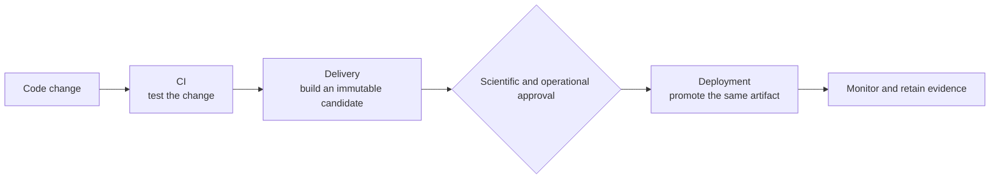

# Bioinformatics CI/CD: Automate And Release

<div class="scenario-panel">
<p class="eyebrow">The local tests passed. Is the pipeline ready to release?</p>
<p>A developer changes a channel name in the ONT workflow. The tiny sandbox still passes because it does not use that channel. A second change updates IsoQuant and reduces the reported transcript count. Neither change is necessarily wrong, but both need a deeper check before the pipeline reaches a research team.</p>
<p><strong>Part 2 tests the rules, the larger workflow graph, and the scientific results. It then runs those checks automatically for every proposed change.</strong></p>
</div>

**Takeaway:** Add safeguards in layers. Reject invalid input, test the full workflow cheaply, compare important results with reviewed baselines, and automate the same repository commands in CI.

[Week 7](week-07-rnaseq-in-seven-minutes.html) built the local foundation: lint, smoke, file-contract, and known-answer tests. Complete that first if terms such as *fixture*, *assertion*, or *exit code* are new.

[Open the shared testing project on GitHub](https://github.com/Caffeinated-Code/Bioinformatics_Field_Guide/tree/main/content/resources/week-07). Both articles use the same scripts and tiny FASTQ fixture.

## From Local Checks To Release Confidence

```mermaid
flowchart LR
  local["Week 7<br/>local checks"] --> rules["5. Invariants<br/>protect general rules"]
  rules --> reject["6. Expected failure<br/>reject bad input"]
  reject --> graph["7. Workflow contract<br/>test the larger graph"]
  graph --> regression["Scientific regression<br/>compare reviewed metrics"]
  regression --> ci["CI/CD<br/>test, deliver, approve"]
```

Keep the Conda environment from Part 1 active for the sandbox examples:

```bash
# Activate the pinned Nextflow, Java, Bash, and Python environment.
conda activate bioinfo-ci-basics

# Confirm that the Part 1 sandbox is still green before adding deeper tests.
bash content/resources/week-07/scripts/run_sandbox.sh
```

The workflow-contract section also uses `nf-test`. Its setup and verification commands are documented in the [project README](https://github.com/Caffeinated-Code/Bioinformatics_Field_Guide/tree/main/content/resources/week-07#install-nf-test).

## Three More Tests You Can Reuse

### 5. Invariant Test: Protect A Rule That Should Always Hold

**Real-life situation:** Transcript counts may change slightly after a valid tool update. You may not know the exact new count. You still know that an allele frequency cannot be above `1`, an interval must have `start < end`, and a report cannot say `PASS` when its threshold failed.

**What this test does:** An invariant protects a rule that should always be true. It can catch impossible output even when you do not know the exact answer.

| Test | Example |
|---|---|
| known answer | this three-read fixture has exactly `36` bases |
| invariant | minimum length must be less than or equal to mean length, which must be less than or equal to maximum length |

```python
def test_lengths_are_ordered(self) -> None:
    minimum = int(self.qc["min_length"])
    mean = float(self.qc["mean_length"])
    maximum = int(self.qc["max_length"])

    self.assertLessEqual(minimum, mean)
    self.assertLessEqual(mean, maximum)
```

The QC table has another rule. If it says `PASS`, the read count must meet the minimum. A table with `PASS`, `reads = 2`, and `minimum_reads = 3` contradicts itself.

```python
def test_quality_gate(self) -> None:
    self.assertEqual(self.gate["status"], "PASS")
    self.assertGreaterEqual(
        int(self.gate["reads"]),
        int(self.gate["minimum_reads"]),
    )
```

Other useful bioinformatics invariants include:

- `0 <= allele_frequency <= 1`
- genomic interval `start < end`
- every input sample appears exactly once in the final summary
- paired files have the same sample identifier
- all reported contigs exist in the declared reference dictionary
- proportions sum to approximately `1`, within a stated numeric tolerance

Use invariants for rules that must hold across many datasets, not just one fixture.

### 6. Expected-Failure Test: Prove Bad Input Is Rejected

**Real-life situation:** A samplesheet is missing a required column, or a sample fails QC. The pipeline must stop. If the validation code is broken, bad input may continue into a report that looks legitimate.

**What this test does:** An expected-failure test gives the pipeline invalid input and checks that it stops for the intended reason. This is also called a negative test.

The positive sandbox has three reads and requires at least three. The negative case keeps the same FASTQ but raises the threshold to four. This is the exact control logic in `test_expected_failure.sh`:

```bash
expected_message='QC failed: expected at least 4 reads, observed 3.'

# We expect a non-zero status, so temporarily prevent set -e from exiting.
set +e
nextflow run "${resource_dir}/sandbox/main.nf" \
  --reads "${resource_dir}/sandbox/data/tiny.fastq" \
  --min_reads 4 \
  --outdir "${outdir}" \
  -work-dir "${workdir}" \
  -ansi-log false >"${log_file}" 2>&1
exit_status=$?  # $? is the exit code from the command immediately above.
set -e

# Failure condition 1: the invalid case was accepted.
if [[ "${exit_status}" -eq 0 ]]; then
  printf 'Expected-failure test failed: three reads were accepted.\n' >&2
  exit 1
fi

# Failure condition 2: it failed, but for the wrong reason.
if ! grep -Fq "${expected_message}" "${log_file}"; then
  printf 'Expected-failure test failed: unexpected reason.\n' >&2
  exit 1
fi

# The harness succeeds because it observed the intended inner failure.
printf 'Expected-failure test: PASS (Nextflow exit code %s)\n' "${exit_status}"
```

Run it:

```bash
bash content/resources/week-07/scripts/test_expected_failure.sh
```

Expected output:

```text
Expected-failure test: PASS (Nextflow exit code 1)
  QC failed: expected at least 4 reads, observed 3.
```

Why check both the code and the message? A missing program, a syntax error, and a valid QC rejection can all return non-zero. The expected message proves that the correct guardrail stopped the run.

### 7. Workflow Contract: Use Stubs To Test A Larger Graph

**Real-life situation:** You rename a channel or move a process into a module. Running NanoPlot, minimap2, samtools, IsoQuant, and SQANTI3 after every small edit would be slow. You first need a cheap way to check that the pipeline is still connected.

**What this test does:** A workflow-contract test checks the process graph, channel connections, metadata, and output names. It uses lightweight **stubs** instead of the real tools.

The Week 6 workflow has five processes:

```text
FASTQ -> FASTQ_QC
     \-> ALIGN_MINIMAP2 -> ALIGNMENT_QC
                        \-> ISOQUANT_DISCOVERY -> SQANTI3_ANNOTATION
```

A stub is a short replacement for a process's real `script` block. It creates outputs with the expected names and channel shape. It does not run the expensive command.

The real alignment script and its stub live together:

```nextflow
script:
"""
# Real mode: align reads, sort the BAM, and create its index.
minimap2 -ax splice ${extra} -t ${task.cpus} ${reference} ${fastq} \
  | samtools sort -@ ${task.cpus} -o ${meta.id}.sorted.bam -
samtools index -@ ${task.cpus} ${meta.id}.sorted.bam
"""

stub:
"""
# Stub mode: create only the two filenames promised by the process contract.
printf 'stub alignment for ${meta.id}\n' > ${meta.id}.sorted.bam
printf 'stub index for ${meta.id}\n' > ${meta.id}.sorted.bam.bai
"""
```

The stub BAM is placeholder text, not a real alignment. That is fine for checking the workflow graph because the downstream processes are also stubbed. Use a real integration test when file content matters.

`nf-test` starts the pipeline in stub mode and checks the execution trace. Here is the complete test, documented line by line:

```groovy
nextflow_pipeline {                         // Declare a whole-pipeline nf-test suite.
  name "Week 6 ONT pipeline wiring"        // Name shown in the test report.
  script "main.nf"                         // Nextflow entry point under test.

  test("runs all five stages with lightweight stubs") { // One test scenario.
    options "-stub-run"                    // Select every process's stub block.

    when {                                  // Define inputs before execution.
      params {
        input = "$baseDir/tests/data/samplesheet.csv" // One tiny sample.
        reference = "$baseDir/tests/data/tiny.fa"     // Tiny reference.
        annotation = "$baseDir/tests/data/tiny.gtf"   // Matching annotation.
        outdir = "$outputDir"              // Isolated directory from nf-test.
      }
    }

    then {                                  // Assertions after execution.
      assert workflow.success               // Nextflow returned success.
      assert workflow.trace.tasks().size() == 5 // All five tasks were scheduled.
      assert workflow.trace.failed().size() == 0 // No task failed.
    }
  }
}
```

Run only this contract:

```bash
bash content/resources/week-07/scripts/run_fast_ci.sh contract
```

Expected output:

```text
Test 'runs all five stages with lightweight stubs' PASSED
SUCCESS: Executed 1 tests
```

This proves that the samplesheet can be parsed, the channels connect, and all five tasks can be scheduled. It does **not** prove that the BAM is valid or that the isoforms are correct. Stubs test wiring, not biology.

## Scientific Regression: Test Results, Not Just Software

**Real-life situation:** You update minimap2 or IsoQuant. The pipeline passes every software test, but the number of transcript models drops from `30` to `26`. That change may be expected, or it may affect the scientific conclusion.

**What this test does:** A scientific regression test compares important results with a reviewed baseline. It stops the release when a change is larger than the allowed tolerance.

The [Week 6 public-data run](week-06-build-custom-nextflow-ont-pipeline.html#run-the-verified-toy-project) produced these versioned expectations with its pinned tools:

```text
metric                         expected  absolute_tolerance
primary_alignments             439       0
transcript_models              30        0
sqanti_classification_rows     30        0
```

These values belong to this simulated fixture and pinned toolchain. They are not universal targets for ONT data.

### The Reproducible Comparison

The project includes three files:

- `baseline.tsv`: reviewed expected values and tolerances
- `observed-pass.tsv`: a passing practice run
- `observed-fail.tsv`: an intentionally changed practice run

Run the passing comparison:

```bash
python3 content/resources/week-07/scripts/check_scientific_regression.py \
  content/resources/week-07/scientific-regression/baseline.tsv \
  content/resources/week-07/scientific-regression/observed-pass.tsv
```

```text
metric                         expected  observed  tolerance  delta  status
primary_alignments             439       439       0          0      PASS
transcript_models              30        30        0          0      PASS
sqanti_classification_rows     30        30        0          0      PASS
Scientific regression: PASS (3 metrics)
```

Now use the intentionally changed observations:

```bash
python3 content/resources/week-07/scripts/check_scientific_regression.py \
  content/resources/week-07/scientific-regression/baseline.tsv \
  content/resources/week-07/scientific-regression/observed-fail.tsv
```

```text
metric                         expected  observed  tolerance  delta  status
primary_alignments             439  439  0  0   PASS
transcript_models              30   26   0  -4  FAIL
sqanti_classification_rows     30   26   0  -4  FAIL
Scientific regression: FAIL
```

The comparator exits `0` when every metric passes. It exits `1` when a metric changed too much, is missing, or was not expected. CI can use that exit code to stop a release.

### Collect The Metrics From A Real Week 6 Run

The included collector makes the metric definitions explicit:

```bash
bash content/resources/week-07/scripts/collect_week06_metrics.sh \
  results/week06-toy/alignments/ISOQUANT_TOY.sorted.bam \
  PATH/TO/ISOQUANT_TOY.transcript_models.gtf \
  PATH/TO/SQANTI_CLASSIFICATION.txt \
  > observed.tsv
```

Under the hood it uses:

```bash
# Count mapped primary records by excluding unmapped (4), secondary (256),
# and supplementary (2048) SAM flags: 4 + 256 + 2048 = 2308.
samtools view -c -F 2308 alignments.bam

# Count transcript feature rows in the model GTF.
awk '$3 == "transcript" { count += 1 } END { print count + 0 }' models.gtf

# Count data rows after the SQANTI3 table header.
awk 'NR > 1 { count += 1 } END { print count + 0 }' classification.txt
```

### Choose Tolerances Deliberately

| Metric | Good comparison style | Example reason |
|---|---|---|
| file schema or sample count | exact equality | any missing sample is unacceptable |
| deterministic toy count | exact equality | input and pinned tools are fixed |
| mapping rate | reviewed absolute tolerance | aligner updates may cause small justified shifts |
| abundance correlation | minimum threshold | exact transcript values may be unnecessarily brittle |
| runtime or memory | percentage budget | infrastructure has natural variation |
| precision and recall on truth data | minimum acceptance thresholds | biological performance matters more than byte identity |

The included comparator uses absolute tolerances. Other projects may use percent change, correlation, F1 score, interval overlap, or distribution tests.

Store the baseline beside the code. Record the fixture checksum, references, tool versions, parameters, and reviewer. Never change a baseline only to make CI green. Investigate the difference first.

## Choose Test Cases, Then Choose When They Run

A pipeline needs more than one happy-path example. Each case below answers a different question.

| Case | What it proves | Example in a bioinformatics pipeline | When to run |
|---|---|---|---|
| **positive** | valid input succeeds | three reads meet a three-read threshold | every pull request |
| **negative** | invalid input is rejected | three reads fail a four-read threshold | every pull request |
| **boundary** | the exact edge is correct | `3` passes while `2` fails when minimum is `3` | every pull request |
| **malformed** | errors are early and useful | samplesheet lacks a required column | every pull request |
| **empty or null** | zero-data behavior is intentional | empty FASTQ, empty VCF, missing annotation | every pull request |
| **truth set** | biological sensitivity or accuracy is retained | known variants, isoforms, or controls | nightly and release |
| **compatibility matrix** | supported environments still work | Java, Nextflow, container engine, or platform versions | scheduled or release |
| **performance** | time, memory, and cost stay acceptable | deep ONT region or cohort-scale input | release and major updates |

Your tiny fixture must still contain the feature you want to test. Keep the splice junction, stranded read, known isoform, low-quality sample, or metadata error. The first few records from a large file may not contain any of them.

## What The Complete Fast Suite Means

Here, the **complete fast suite** means every check that is quick enough for a pull request. It does not download the large Week 6 container or run the public dataset.

```bash
bash content/resources/week-07/scripts/run_fast_ci.sh
```

No argument defaults to `all`, which runs these targets in order:

| Target | What runs | What does not run |
|---|---|---|
| `versions` | Nextflow, nf-test, and Python version inventory | analysis |
| `lint` | static analysis of eight Week 6 files | processes |
| `contract` | five Week 6 tasks with stubs | real bioinformatics tools |
| `sandbox` | real two-process tiny workflow, file checks, six assertions | Week 6 containers |
| `negative` | deliberate QC rejection | public data |

Run one target while debugging:

```bash
bash content/resources/week-07/scripts/run_fast_ci.sh lint
bash content/resources/week-07/scripts/run_fast_ci.sh contract
bash content/resources/week-07/scripts/run_fast_ci.sh sandbox
bash content/resources/week-07/scripts/run_fast_ci.sh negative
```

Run the public dataset and scientific regression on a schedule or before a release. A fast suite is useful, but it is not complete scientific validation.

## Automate The Same Test In GitHub Actions And Jenkins

**Real-life situation:** The tests pass on your laptop, but a teammate forgets to run them before merging. CI removes that manual step.

Keep the test logic in the repository, not inside the automation platform. GitHub Actions and Jenkins should call the same versioned command:

```bash
bash content/resources/week-07/scripts/run_fast_ci.sh sandbox
```

### GitHub Actions

GitHub reads YAML files from `.github/workflows/`. A pull request starts the workflow. GitHub creates a temporary runner and executes each step in order.

```yaml
name: Tiny FASTQ sandbox

on:
  workflow_dispatch:             # Add a Run workflow button in GitHub.
  pull_request:                  # Also run for proposed changes.

permissions:
  contents: read                 # The job only needs to read repository files.

jobs:
  sandbox:
    runs-on: ubuntu-latest       # Start a clean GitHub-hosted Linux runner.
    timeout-minutes: 10          # Stop a hung workflow.

    steps:
      - uses: actions/checkout@v7 # Download the exact commit being tested.

      - uses: nf-core/setup-nextflow@v3
        with:
          version: '26.04.2'     # Pin the tested Nextflow version.
          java-version: '17'     # Pin the supported Java runtime.
          java-distribution: 'temurin'

      - name: Run the sandbox
        run: bash content/resources/week-07/scripts/run_fast_ci.sh sandbox

      - name: Keep outputs for debugging
        if: always()             # Run even when the test step is red.
        uses: actions/upload-artifact@v7
        with:
          name: sandbox-results
          path: build/sandbox/
```

What happens after a pull request opens:

1. GitHub creates a clean Ubuntu runner.
2. `checkout` downloads the exact commit.
3. `setup-nextflow` installs pinned Java and Nextflow versions.
4. The same local sandbox command runs.
5. A non-zero command status turns the job red.
6. Small output files remain downloadable for debugging.

The [shared GitHub Actions workflow](https://github.com/Caffeinated-Code/Bioinformatics_Field_Guide/blob/main/.github/workflows/week-07-pipeline-ci.yml) runs the complete fast suite, limits permissions, filters paths, cancels superseded runs, and uploads test evidence.

### Jenkins

Jenkins reads a `Jenkinsfile` from source control. A pipeline receives an agent, stages group work, and `post` actions preserve evidence.

```groovy
pipeline {
  agent { label 'bioinformatics-ci' } // Use a prepared private agent.

  options {
    timestamps()                      // Timestamp log lines.
    timeout(time: 10, unit: 'MINUTES')
  }

  stages {
    stage('Tiny FASTQ sandbox') {      // A named unit in the Jenkins UI.
      steps {
        sh 'bash content/resources/week-07/scripts/run_fast_ci.sh sandbox'
      }
    }
  }

  post {
    always {                           // Preserve output after pass or failure.
      archiveArtifacts artifacts: 'build/sandbox/**', fingerprint: true
    }
  }
}
```

The `bioinformatics-ci` agent needs Java 17, Nextflow 26.04.2, Bash, and Python 3. A versioned container or machine image makes that environment easier to reproduce.

The [complete Jenkinsfile](https://github.com/Caffeinated-Code/Bioinformatics_Field_Guide/blob/main/content/resources/week-07/Jenkinsfile) separates versions, lint, nf-test, sandbox, and negative testing into visible stages and publishes the JUnit report.

### Translate The Concepts, Not The Syntax

| Concept | GitHub Actions | Jenkins |
|---|---|---|
| configuration file | `.github/workflows/*.yml` | `Jenkinsfile` |
| compute | runner | agent/node |
| grouping | job | stage |
| command | `run:` step | `sh` step |
| saved output | artifact | archived artifact |
| test report | uploaded JUnit or annotations | `junit` publisher |
| secret | Actions secret/environment | Jenkins credential |

Use GitHub Actions when the code is on GitHub and the data can run on an approved runner. Use Jenkins when the job must reach an internal HPC cluster, private registry, or controlled network. With Jenkins, your team maintains the server, plugins, credentials, and agents.

Never place protected patient data or production credentials on a public runner. Public CI should use synthetic, public, or explicitly approved fixtures.

## CI Is Only The First Third

CI/CD is often used as one phrase, but it covers three different jobs:



| Stage | Bioinformatics meaning | Evidence to keep |
|---|---|---|
| **continuous integration** | lint and test each proposed change | logs, JUnit, small outputs, commit SHA |
| **continuous delivery** | create a release candidate that is always ready for approval | tag, changelog, test reports, checksums, container digest, SBOM, provenance |
| **continuous deployment** | automatically promote every passing candidate | deployment history, approved config, rollback target, monitoring |

For a bioinformatics pipeline, deployment may mean:

- publishing a versioned Nextflow release
- pushing a container image to a registry
- updating the approved pipeline revision in Seqera Platform
- promoting a config to an HPC module or AWS Batch environment
- making a signed workflow package available to an internal analysis team

### A Safer Release Path For Scientific Pipelines

1. A pull request runs the fast suite.
2. Scheduled testing runs real tools on a stable public or approved validation set.
3. A version tag starts release testing.
4. CI builds the container once and records its immutable digest.
5. Delivery creates a release candidate with checksums, provenance, reports, and release notes.
6. A scientist reviews changed metrics; an operator reviews security and infrastructure evidence.
7. An environment approval promotes the **same digest** to production. Do not rebuild it.
8. The previous approved digest remains available for rollback.

GitHub environments can require a reviewer before deployment. Jenkins can pause at an `input` approval step. In both systems, deploy the exact version or container digest that was tested. Do not replace it with an unpinned `latest` tag.

**Recommendation:** use continuous delivery for most research and regulated pipelines. Keep a human approval before deployment when a release can change scientific interpretation or patient-facing decisions. Fully automatic deployment is better suited to low-risk internal tools with reliable monitoring and rollback.

This is the end-to-end map. Signed containers, SBOMs, attestations, rollback drills, and cloud promotion deserve a separate advanced implementation guide.

## Playbooks Worth Bookmarking

| Resource | Use it for |
|---|---|
| [nf-test getting started](https://www.nf-test.com/docs/getting-started/) | generating and writing Nextflow process, workflow, and pipeline tests |
| [nf-core development guide](https://nf-co.re/docs/developing/overview) | a mature structure for modules, testing, documentation, containers, and CI |
| [nf-core pipeline guidelines](https://nf-co.re/docs/guidelines/pipelines/overview) | a checklist for professional, community-ready pipeline releases |
| [GitHub Actions CI guide](https://docs.github.com/en/actions/get-started/continuous-integration) | workflow events, runners, jobs, and pull-request checks |
| [GitHub secure-use reference](https://docs.github.com/en/actions/reference/security/secure-use) | permissions, secrets, untrusted input, and third-party action risks |
| [GitHub deployment environments](https://docs.github.com/en/actions/concepts/workflows-and-actions/deployment-environments) | approvals, protected environments, deployment history, and scoped secrets |
| [Jenkins Pipeline handbook](https://www.jenkins.io/doc/book/pipeline/) | pipeline-as-code, agents, stages, reports, and delivery workflows |
| [SLSA specification](https://slsa.dev/spec/v1.2/) | supply-chain provenance and increasing assurance for built artifacts |

Do not copy a large CI template before understanding its checks. Start with one local command, make its failure useful, and then let a larger playbook add scale and governance.

## When A Test Turns Red

| Failure | Read first | Next action |
|---|---|---|
| lint error | named file, line, and parser message | fix syntax before running anything else |
| smoke test stops | Nextflow process name and `.command.err` | inspect command, tool availability, and task exit status |
| missing output | process `output:` declaration and generated filename | repair filename, glob, or channel wiring |
| wrong header | first output line and schema contract | fix writer or deliberately version the schema |
| unit assertion | observed-versus-expected diff | inspect calculation, parser, and fixture assumption |
| invariant | contradictory metrics | trace where the relationship became impossible |
| negative test | exit code and expected error text | ensure invalid input is rejected for the intended reason |
| nf-test contract | execution trace | repair process dependencies, metadata, or stubs |
| scientific regression | metric delta plus tool/reference versions | investigate; update baseline only after review |
| remote CI only | printed versions, architecture, and permissions | remove hidden local dependencies and pin environments |

Do not immediately change an expected value to make a red build green. First decide whether the code is wrong, the test is wrong, or the intended behavior legitimately changed.

## The Bookmark Checklist

- [ ] One repository clone provides Week 6 and Week 7 in sibling directories.
- [ ] A new contributor can run the self-contained sandbox with one command.
- [ ] Linting is separated from execution tests.
- [ ] Smoke tests use the smallest meaningful path and preserve readable failures.
- [ ] Every important output has a filename, integrity, and schema contract.
- [ ] Known-answer tests use values independently calculated from a tiny fixture.
- [ ] Invariants protect general mathematical or scientific relationships.
- [ ] Positive, negative, boundary, malformed, and empty cases are considered.
- [ ] nf-test stubs test wiring without being mistaken for real biological output.
- [ ] Scientific baselines include metrics, tolerances, versions, references, and review.
- [ ] The complete fast suite is distinct from slow public-data validation.
- [ ] Local, GitHub Actions, and Jenkins execution call the same repository scripts.
- [ ] Delivery preserves immutable artifacts, checksums, provenance, and reports.
- [ ] Production promotion uses approval and the exact artifact that was tested.
- [ ] Protected data and credentials stay on approved infrastructure.

## Continue The Infrastructure Path

Once the release process is trustworthy, the next question is where the workflow should run. The [cloud execution companion](nextflow-workflow-tools-aws-companion.html) compares workflow managers and introduces Nextflow on AWS Batch without mixing cloud infrastructure into this CI/CD lesson.

## Credits And References

- Forer L, Schoenherr S. [Improving the reliability, quality, and maintainability of bioinformatics pipelines with nf-test](https://doi.org/10.1093/gigascience/giaf130). *GigaScience*. 2025.
- Di Tommaso P, Chatzou M, Floden EW, et al. [Nextflow enables reproducible computational workflows](https://doi.org/10.1038/nbt.3820). *Nature Biotechnology*. 2017.
- [Python `unittest` documentation](https://docs.python.org/3/library/unittest.html)
- [Nextflow CLI and lint reference](https://www.nextflow.io/docs/latest/reference/cli.html)
- [Nextflow process stubs](https://www.nextflow.io/docs/latest/process.html#stub)
- [nf-test pipeline testing](https://www.nf-test.com/docs/testcases/nextflow_pipeline/)
- [GitHub Actions workflow syntax](https://docs.github.com/en/actions/reference/workflows-and-actions/workflow-syntax)
- [GitHub deployment environments](https://docs.github.com/en/actions/concepts/workflows-and-actions/deployment-environments)
- [Jenkins Pipeline documentation](https://www.jenkins.io/doc/book/pipeline/)
- [nf-core pipeline linting](https://nf-co.re/docs/nf-core-tools/cli/pipelines/lint)
